# AGENTS.md — Screen Demo Studio 아키텍처 및 엔지니어링 핵심 원칙

이 문서는 **Screen Demo Studio (`ai-screen-studio`)**의 아키텍처, 파이프라인, 그리고 AI 에이전트가 코드를 수정·검증할 때 반드시 준수해야 하는 핵심 엔지니어링 원칙을 정의합니다.

---

## 1. 프로젝트 개요 및 핵심 철학 (Core Philosophy)

* **프로젝트명**: Screen Demo Studio (`ai-screen-studio`)
* **대시보드 주소**: `http://localhost:3333` (`npm run dashboard` / `scripts/dashboard-server.ts`)
* **핵심 철학 2대 원칙**:
  1. **클릭한 대로 정확히 재현 (What You Click Is What Gets Recorded)**:
     사용자가 동작 감지(스포이드, `actionRecorderService.ts`)로 직접 클릭·호버·드래그·타이핑한 액션은 재생 엔진(`scripts/record.ts`)에서 **사용자가 의도한 바로 그 요소**에 1:1로 정확히 재현되어야 합니다. 엉뚱한 첫 번째 행을 클릭하거나 배경 버튼을 오클릭하는 일을 원천 차단합니다.
  2. **전 모듈 범용 설계 (Universal Multi-Module Design — No Single-Scenario Hacks)**:
     일정관리, 전자결재, 문서관리, 게시판, 자원예약, 스마트워크, 전자우편, 조직도 등 그룹웨어의 어떤 모듈에서 시나리오가 생성되더라도 동일하게 작동하는 **범용 메커니즘**으로 해결해야 합니다. 특정 시나리오 한두 개만 통과시키기 위한 하드코딩이나 `browse-plan.json` 수동 조작을 엄격히 금지합니다.

---

## 2. 시스템 파이프라인 및 주요 파일 구조

```mermaid
graph LR
    UI[웹 대시보드 :3333] -->|동작 감지 스포이드| Recorder[src/services/actionRecorderService.ts]
    UI -->|자연어 시나리오 생성| Planner[src/services/geminiPlanner.ts]
    Recorder --> Sanitizer[src/services/planSanitizer.ts]
    Planner --> Sanitizer
    Sanitizer -->|browse-plan.json| Runner[scripts/record.ts]
    Runner <-->|실시간 복구 / DB 폴백| Healer[src/services/elementSelfHealer.ts]
    Runner -->|recording.mp4 + moments.json| EditPlan[scripts/build-edit-plan.py]
    EditPlan -->|edit-plan.json| Narration[src/services/narrationService.ts & scripts/synthesize-tts.py]
    Narration -->|TTS MP3 + 자막/타임라인| Remotion[src/Root.tsx & src/services/renderRunner.ts]
```



| 구분 | 파일 경로 | 역할 |
| :--- | :--- | :--- |
| **대시보드 서버/UI** | `scripts/dashboard-server.ts`, `dashboard/index.html`, `dashboard/style.css`, `dashboard/app.js` | 시나리오 관리, 스포이드 동작 감지, 대본/타임라인 편집, 녹화/렌더링 실행 및 SSE 로그 중계 |
| **동작 감지(스포이드)** | `src/services/actionRecorderService.ts` | 실시간 브라우저에서 사용자의 `click`, `hover`, `drag`, `type` 동작 및 `targetHtml` 포착 |
| **AI 플래너 & 카탈로그** | `src/services/geminiPlanner.ts`, `src/services/groupwareCatalog.ts` | 자연어 프롬프트 기반 시나리오 생성 및 그룹웨어 모듈별 표준 DOM 규격 제공 |
| **플랜 정제기** | `src/services/planSanitizer.ts` | 셀렉터 문법 정규화, `targetHtml` 기반 고유 속성/텍스트 보강, 중복 타이핑/호버 및 오탐 드래그 정리 |
| **브라우저 녹화 엔진** | `scripts/record.ts` | Playwright 기반 시나리오 재생, 모달/트리/드래그/피커 제어, On-Demand DB 스크래핑 폴백, `recording.mp4` & `moments.json` 생성 |
| **실시간 자가 치유** | `src/services/elementSelfHealer.ts` | 런타임 요소 탐색 실패 시 실시간 DOM 후보군 + 화면 캡처 기반 멀티모달 복구 |
| **AI 대본 & TTS 합성** | `src/services/narrationService.ts`, `scripts/synthesize-tts.py`, `src/components/NarrationTrack.tsx` | 도입부 요약·범용 매뉴얼 대본 생성(스타일/어조 선택), Edge-TTS 음성 합성 및 오디오 트랙 렌더링 |
| **편집 플랜 & 렌더링** | `scripts/build-edit-plan.py`, `scripts/calibrate-moments.py`, `src/components/SyntheticCursor.tsx`, `src/services/renderRunner.ts` | 줌/팬 키프레임 산출, 가상 마우스 커서/클릭 물결/내레이션 합성, 최종 MP4 렌더링 |

---

## 3. 7대 핵심 엔지니어링 원칙 (Engineering Rules)

### 원칙 1. 동작 감지(스포이드) 셀렉터 생성 및 이벤트 캡처 정밀화 (`actionRecorderService.ts`)
1. **고유 식별 속성 및 정확 텍스트 최우선 배치**:
   - 동적 목록이나 트리(`#orgUserList`, `#resSelect_resList`, `.dynatree-container` 등)에서 `:nth-of-type(n)` 같은 **순서 의존 셀렉터**를 맨 앞에 두면 목록 순서가 바뀌거나 다중 항목이 있을 때 엉뚱한 첫 번째 항목을 클릭하게 됩니다.
   - 반드시 **`id` / `name` / 고유 데이터 속성(`data-res-id`, `data-dept-id`, `data-emp-id`, `data-cmp-id`, `data-cal-id`, `data-brd-id`, `data-trgt-id`) → 정확한 텍스트/타이틀 매칭(`:text-is('...')`, `[title='...']`, `:has-text('...')`) → 구조적 경로(`:nth-of-type`)** 순서로 후보 셀렉터를 구성합니다.
   - 텍스트가 35자를 초과하더라도 절삭 텍스트(최대 40자) 기반 `:has-text('...')` 후보를 반드시 생성하여 `:nth-of-type(n)`보다 앞쪽에 배치합니다.
2. **가시성 기반 중복 DOM ID 판별(`isStableId`) 및 숫자로 시작하는 클래스 처리**:
   - 레거시 화면(예: 주소록 연락처 등록 `#th7`)처럼 화면에 보이는(`visible`) 요소 중 중복 선언된 `id`나 테이블 헤더 번호 패턴(`/^th\d+$/i`)은 거부하되, 숨겨진 템플릿에만 동명 ID가 있고 **실제 보이는(`visible`) 요소가 유일한 경우(예: `#gapWorkSelect_searchWord`)**에는 고유 ID로 정상 채택합니다.
   - 자원예약 타임슬롯(`<dd class="1400">`)처럼 숫자로 시작하는 클래스명은 CSS 문법 에러를 방지하기 위해 `[class~='1400']` 속성 선택자 형태로 생성합니다.
3. **일시적 런타임 상태 클래스 제거**:
   - `.dynatree-expanded`, `.dynatree-has-children`, `.dynatree-folder`, `.dynatree-lastsib`, `.dynatree-exp-*`, `.dynatree-ico-*`, `.ui-state-*`, `.hover`, `.active`, `.focus`, **`.chkbox_on`, `.rdobtn_on`, `.ico_chk_on`** 등 클릭 시점의 UI 상태에 따라 변하는 클래스는 셀렉터에서 제외합니다.
4. **체크박스/라디오 합성 더블클릭 차단 및 행 스코핑**:
   - `<label><input type="checkbox"></label>` 클릭 시 브라우저가 발생시키는 `<label>` → `<input>` 연속 합성 클릭(80ms 이내)을 차단하여 체크 즉시 해제되는 현상을 방지합니다.
   - 사원/항목 목록의 체크박스 셀렉터는 공통 `title="선택"`보다 행 텍스트 스코핑(`li:has-text('...') input[type='checkbox']:visible`)을 최우선 배치합니다.
5. **중복 타이핑(`Enter` `keyup`), 중복 카드 호버, 자기 자신 드래그(`dragAndDrop`) 오탐 방지**:
   - **중복 타이핑 차단**: `Enter` 키를 눌러 `flushPendingType()`이 실행된 직후 손가락을 뗄 때 발생하는 `keyup(Enter)` 이벤트나 비문자 제어 키(`Tab`, `Escape`, 방향키 등)로 인해 `lastTypedElement`가 재장전되어 동일 입력값이 2번 기록되는 현상을 차단합니다(`lastFlushedElement`, `lastFlushedValue` 추적).
   - **양식 카드 중복 `hover` 차단**: 양식 카드(`.app_work_box`, `li.aw_li`) 위에서 400ms 체류 타이머로 이미 `hover`가 기록된 경우(`window.__sdLastRecordedHoverCard`), 직후 카드 내부 `[작성]` 버튼 클릭 시 중복 `hover`를 또 생성하지 않습니다. 또한 카드 셀렉터는 반드시 `li.aw_li:has-text('양식명')`으로 스코핑합니다.
   - **자기 자신 트리 노드 `dragAndDrop` 오탐 차단**: 트리 항목(`.dynatree-node`) 클릭 시 미세한 마우스 흔들림(5px 이상)으로 인해 상위 `.dynatree-container`나 자기 자신 노드가 드롭 타겟(`candidate.contains(sourceEl)`)으로 잡혀 엉뚱한 `dragAndDrop`이 기록되지 않도록 `isSameOrSelfDropTarget()`으로 엄격히 차단합니다.
   - **웹 에디터(`div.se-contents`, `textarea.se-ime`)**: 게시판·사내쪽지·전자결재 등의 Synap Editor `iframe` 내 본문 타이핑을 감지하고, 다른 프레임 클릭 시 `window.top.__sdFlushCallbacks`를 통해 모든 프레임의 타이핑 버퍼를 즉시 플러시합니다.

### 원칙 2. 플랜 정제기(`planSanitizer.ts`) 보존 및 자동 클린업 규칙
1. **`recordedByEyedropper: true` 액션 존중 및 `targetHtml` 보강**:
   - 사용자가 직접 녹화한 액션의 의도를 임의로 삭제하거나 엉뚱한 셀렉터로 덮어쓰지 않습니다.
   - `1-E` 정제 단계에서 `click`, `hover`, **`type`** 액션의 `targetHtml` 내부 고유 `id`, `data-*`, `[class~='...']`, `[title='...']`, `:text-is('...')` 셀렉터를 추출하여 `:nth-of-type(n)` 후보보다 앞쪽에 보강합니다.
2. **후처리 자동 클린업 (Section 11 — 중복 `type`/`hover` 및 오탐 자기 드래그 제거)**:
   - 기존에 저장된 시나리오를 로드할 때도 동일 입력창에 연속/교차 기록된 `[type → hover → type → hover]` 중복 시퀀스를 자동 병합합니다.
   - 동일 트리 노드에 대한 자기 자신 `dragAndDrop` 오탐 액션 및 그로 인해 파생된 실패 알림창 확인 단계를 자동 제거하고 정상 클릭 단계로 직결합니다.

### 원칙 3. 모달 스코핑, On-Demand DB 스크래핑, 트리/드래그 정밀 제어 (`scripts/record.ts`)
1. **선제적(Pre-emptive) DB 스크래핑 금지 → On-Demand 자가 치유(`trySelfHealAction`) 스크래핑 원칙**:
   - `case "type":` 단계에서 사용자가 입력한 검색어(예: `'테스트'`, `'홍길동'` 등)를 가짜 텍스트로 오판하여 검색 실행 전에 화면 첫 번째 항목(`"기안(5인이하)"` 등)을 미리 스크래핑하거나 후속 액션들의 셀렉터/설명을 덮어쓰는 행위를 **절대 금지**합니다.
   - 입력 전 기존 값을 비우고(`el.fill("")`), 검색 입력창(`search`, `srch`, `검색` 등)에 타이핑한 뒤 다음 단계가 명시적 검색 버튼 클릭이 아니면 **자동으로 `Enter` 키(`el.press("Enter")`)를 눌러 검색 필터링을 트리거**합니다.
   - **실시간 DB 스크래핑은 오직 후속 클릭/호버 대상(양식 카드 `aw_li`/`btn_write` 또는 목록 항목)이 현재 DB 환경에 존재하지 않아 1차 탐색이 실패했을 때만 `trySelfHealAction` 내부에서 On-Demand로 가동**합니다.
2. **최상단 활성 모달(`.ui-dialog:visible`) 스코핑 및 `body` 직하단 팝오버 예외 허용**:
   - 화면에 `.ui-dialog:visible` 모달이 열려 있을 때는 가장 높은 `z-index`를 가진 최상단 모달 내부에서 우선 탐색하되, 달력/시간 피커·자동완성 팝오버(`datepicker`, `timepicker`, `ui-state-default`, `autocomplete`, `select2`)는 `page` 루트 탐색을 허용합니다.
3. **시스템 알림창(`[확인]`) 다단계 처리 및 중복 생성 알림(`isDuplicateNameError`) 자동 복구**:
   - 트리/조직도 선택 팝업 닫힘 직후 알림창 확인 버튼은 `#alert_lyr:visible button:has-text('확인')`, `button#naon-cmm-alert-confirm:visible` 등 실제 시스템 알림창만 매칭합니다.
   - 동일 이름 중복 알림(`존재합니다`, `중복`, `이미 등록`) 발생 시 알림창 확인 후 열려 있는 생성 모달을 닫아 후속 시나리오가 끊김 없이 진행되도록 복구합니다.
4. **범용 드래그 앤 드롭(`drag` / `dragAndDrop`) 정밀 제어**:
   - 소스 요소와 타겟 컨테이너를 탐색할 때 의미론적 컨테이너(실제 드래그 가능한 항목과 실제 드롭 영역)를 정확히 매칭하고 부드러운 마우스 이동 경로(`steps`)와 이벤트를 발생시켜 드롭 데이터가 누락되지 않도록 보장합니다.

### 원칙 4. 실시간 AI 자가 치유 (`elementSelfHealer.ts`)
1. **무추측 원칙 (Zero-Guessing Policy)**:
   - 화면에서 실시간 추출한 `LiveDOMCandidate` 목록에 존재하지 않는 가상 ID를 추측하여 생성하지 않습니다.
2. **2-Pass 클린 마스터 재녹화**:
   - 1차 녹화 중 자가 치유(`totalHealedCount > 0`)가 발생하여 대기 공백이 생겼다면, 치유된 셀렉터를 `browse-plan.json`에 영구 반영한 뒤 자동으로 `--clean-pass` 재녹화를 수행하여 끊김 없는 최종 영상을 생성합니다.

### 원칙 5. AI 내레이션 대본 생성 및 TTS 음성 합성 (`narrationService.ts`, `synthesize-tts.py`)
1. **오프닝 매뉴얼 개요 대본(`0.2s`) 자동 포함**:
   - 영상 시작 직후(`startTime: 0.2`) 이 시나리오가 어떤 업무 매뉴얼을 시연하는지 안내하는 도입부 설명 구간을 자동 생성합니다.
2. **매뉴얼 해설형 대본 원칙 (Why & Effect — 단순 '버튼 낭독기' 및 시나리오별 하드코딩 금지)**:
   - 단순히 `"'업무 등록' 버튼을 클릭합니다"`, `"'확인' 버튼을 눌러 적용합니다"`처럼 클릭 로그를 나열하지 않고, **왜 해당 메뉴나 버튼을 누르는지, 어떤 창이 열리며 어떤 기능적 효과가 적용되는지**(`"'업무 등록' 버튼을 눌러 업무함 선택 창을 엽니다"`, `"담당자 항목의 '선택'을 눌러 대상 사원을 지정하고 '확인'을 클릭합니다"`, `"공개 여부 옵션에서 '비공개'를 선택합니다"`)를 설명합니다.
   - 특정 시나리오 문구를 코드에 하드코딩(`draftHint` 강제 주입)하거나 화면에 없는 전제조건(예: `'비공개'`에 `'지정된 담당자만'` 등을 지어내는 행위)을 금지하며, 구조적 워크플로우 단계(`StructuralRole`) 그룹핑과 실제 액션 맥락(`rawActions`, `structuredFacts`)을 기반으로 Gemini AI가 직접 자연스러운 매뉴얼 해설을 생성하도록 합니다.
3. **예시 입력/선택값의 범용 가이드 문구화 (Concrete Example → General Instruction)**:
   - 시나리오 액션에 `'16일'`, `'26'`, `'회의실'`, `'테스트'`, `'홍길동'` 같은 구체적인 예시 텍스트가 들어 있더라도, 대본에서는 예시값을 그대로 읽지 않고 실제 매뉴얼 시청자를 위한 범용 안내 문구로 작성합니다.
   - 단, 매 문장마다 기계적으로 `'원하는 ~'`을 반복하지 않도록 문맥에 맞는 자연스러운 어휘(`등록할`, `검색할`, `담당할`, `해당하는`, `필요한` 등)로 변주합니다.
4. **말투/스타일 선택 및 TTS 음성 프로소디 연동**:
   - 대본 생성 시 4가지 스타일(`manual` 정석 매뉴얼 해설형, `friendly` 친절한 강사형, `presentation` 전문 시연 발표형, `compact` 핵심 요약 브리핑형)을 선택할 수 있으며, 스타일에 따라 Edge-TTS 음성 모델과 속도(`rate`)·음높이(`pitch`)가 자동 매핑됩니다.
5. **대시보드 대본 구간 스마트 삽입**:
   - 대시보드에서 `[+ 구간 추가]` 클릭 시 무조건 맨 끝에 추가하지 않고, 현재 선택된 대본 구간 또는 비디오 플레이어의 현재 재생 시점(Playhead) 바로 뒤에 자연스럽게 삽입합니다.

### 원칙 6. 대시보드 UI/UX 구성 원칙 (`dashboard/`)
1. **시나리오 & 영상 플레이어 가독성 최적화**:
   - 좌측 시나리오/액션 편집 영역과 우측 비디오 미리보기/타임라인/내레이션 편집 영역의 정보 밀도를 분리하고, 서브 탭 및 직관적인 배지/컨트롤 레이아웃을 유지합니다.

### 원칙 7. 검증 및 운영 수칙 (Operational & Verification Rules)
1. **대시보드 서버 에이전트 직접 실행 절대 금지**:
   - 에이전트가 `npm run dashboard`나 `scripts/dashboard-server.ts`를 직접 실행하면 사용자의 크롬 창이 정상적으로 뜨지 않거나 포트 충돌이 발생합니다. **대시보드 서버 시작은 항상 사용자가 직접 수행**하며 에이전트는 절대 실행하지 않습니다.
2. **`browse-plan.json` 수동 편집 절대 금지**:
   - 테스트를 통과시키기 위해 `data/<slug>/browse-plan.json`을 직접 수정하지 마십시오. 시나리오 정제가 필요하면 `planSanitizer.ts`를, 캡처 개선이 필요하면 `actionRecorderService.ts`를, 런타임 재생 개선이 필요하면 `scripts/record.ts`를 수정해야 합니다.
3. **백그라운드 데몬 실행 금지 (`IsDaemon: false`)**:
   - 명령어 실행 시 `IsDaemon: true`로 백그라운드 프로세스를 띄우지 마십시오.
4. **프레임 단위 시각 검증 (Visual Frame Verification)**:
   - 녹화 테스트 후에는 반드시 `recording.mp4`에서 프레임을 추출하여 실제 화면에서 체크박스 선택, 팝업 닫힘, 입력값 반영, 최종 저장 결과가 정상인지 확인하고 검증용 임시 프레임 이미지는 즉시 삭제합니다.

---

## 4. 자주 쓰는 실행 명령어

```bash
# 1. 특정 시나리오 브라우저 녹화 실행 (헤드리스 / 화면 표시)
# (주의: npm run dashboard 는 사용자가 직접 실행하므로 에이전트가 실행하지 말 것)
npx tsx scripts/record.ts <slug> --headless
npx tsx scripts/record.ts <slug> --headed

# 2. 줌/팬 편집 플랜 단독 재생성
python scripts/build-edit-plan.py data/<slug>/

# 3. TypeScript 전체 타입 검사
npx tsc --noEmit
```

---

## 5. 최근 세션 완료 내역 및 다음 세션 인수인계 (Handoff Status)

### 5.1 최근 세션에서 해결 및 구현 완료된 핵심 사항
1. **`live-demo-167732` 실시간 DB 스크래핑 충돌 및 중복 타이핑/호버/오탐 드래그 근본 해결**:
   - `scripts/record.ts`: `case "type":`에서 `'테스트'`를 가짜 텍스트로 오판해 `"기안(5인이하)"`를 선제 스크래핑하고 후속 액션을 덮어쓰던 로직을 제거했습니다. 이제 사용자가 입력한 검색어를 그대로 타이핑(기존값 초기화 + 검색창 자동 `Enter` 키 입력)하며, DB 환경 차이로 양식 카드를 못 찾을 때만 `trySelfHealAction`에서 On-Demand로 실시간 DB 스크래핑 폴백이 동작합니다.
   - `src/services/actionRecorderService.ts`: `Enter` 키 `keyup` 시 `lastTypedElement`가 재장전되어 `type`이 2번 기록되던 버그, 양식 카드 `[작성]` 클릭 시 이미 기록된 `hover`가 중복 기록되던 버그, 트리 항목 클릭 시 미세 마우스 이동으로 자기 자신에게 `dragAndDrop`이 기록되던 버그(`isSameOrSelfDropTarget`), 숨겨진 중복 ID 때문에 `#gapWorkSelect_searchWord` ID가 누락되던 문제를 모두 수정했습니다.
   - `src/services/planSanitizer.ts`: 기존에 녹화된 플랜(`live-demo-167732` 등)을 실행할 때도 중복 `[type → hover → type → hover]` 시퀀스와 자기 자신 트리 드래그(`'그룹웨어TFT'` 드래그 + 알림창 확인) 단계를 자동 정리하도록 Section 11 클린업 로직을 추가했습니다.
2. **드래그 앤 드롭(Drag & Drop) 범용 정밀화**:
   - 스포이드 캡처 시 실제 드래그 요소와 드롭 컨테이너를 정확히 분리 포착하고, `scripts/record.ts` 재생 시 의미론적 타겟 해석 및 마우스 이동 보간을 통해 드롭 시 데이터가 정상 반영되도록 개선했습니다.
3. **AI 내레이션 대본 생성 고도화 및 스타일/TTS 연동 (`narrationService.ts`, `synthesize-tts.py`)**:
   - 영상 시작 시 매뉴얼 전체 개요를 안내하는 오프닝 대본(`0.2s`) 자동 삽입.
   - 시나리오의 구체적 예시값(`16일`, `회의실`, `테스트` 등)을 그대로 읽지 않고 범용 매뉴얼 가이드 문구로 변환하는 프롬프트/후처리 규칙 적용.
   - 대본 말투/스타일 선택(`formal` 정중함, `friendly` 친근함, `concise` 간결함) UI 및 Edge-TTS 음성·속도·피치 연동.
   - 대본 구간 추가 시 무조건 맨 끝이 아니라 현재 선택 구간/재생 위치 바로 뒤에 삽입하도록 개선.
4. **대시보드 UI/UX 전면 개선 (`dashboard/index.html`, `style.css`, `app.js`)**:
   - 시나리오 편집 영역과 비디오 플레이어/내레이션/타임라인 컨트롤 영역의 가독성 및 레이아웃 개선.
5. **위키(`live-demo-219401`) 등 `targetHtml` 기반 1:1 재현 실패 6대 근본 원인 해결 (`planSanitizer.ts`, `actionRecorderService.ts`, `scripts/record.ts`)**:
   - **후보 셀렉터 2개 절삭 및 미검증 반환 버그 수정 (`scripts/record.ts`)**: `getLocatorWithWait()`에서 상위 2개 후보(`parts.slice(0, 2)`)만 잘라 호출할 때 `getLocator()`의 마지막 폴백(`page.locator(...).first()`)이 비가시성 객체를 반환하여 3~5번째 정상 셀렉터가 아예 평가되지 않던 문제를 `await el.isVisible()` 검증으로 해결했습니다.
   - **`targetHtml` 정규식 단어 경계(`\b`) 및 자식 `<input id>` 오추출 차단 (`planSanitizer.ts`)**: `/\bid=/` 정규식이 하이픈(`-`)을 단어 경계로 인식해 `data-menu-id="wikiRecentPage"`나 `data-book-id="WBB01..."`를 가짜 `#id` 셀렉터로 만들던 버그와, `<label class="chkbox"><input id="wikiBookReg_cmntUseYn" ...>`에서 외부 `<label>`과 내부 숨김 `<input id>`를 합쳐 `label#wikiBookReg_cmntUseYn`을 만들던 버그를 수정하여 최상위 여는 태그(`^<tag[^>]*>`)에서만 속성을 추출하고 `label.chkbox:has(#childId):visible`로 정확히 매핑했습니다.
   - **비(非)양식카드 `btn_write` 버튼에 대한 허위 호버 주입 차단 (`planSanitizer.ts`)**: 전자결재 양식 카드(`aw_li` / `app_work_box`)가 아닌 일반 모듈(위키 등)의 `button.btn_write._write` 앞에 양식 카드 호버 단계가 자동 삽입되던 문제를 차단하고 기존 오주입 단계도 자동 제거했습니다.
   - **사이드바 `#snb` 하드코딩 제거 및 `contenteditable` 제목/본문 충돌 해결 (`actionRecorderService.ts`)**: `.snb` 요소가 고유 ID(`#wikiMain_snb`)를 가질 때 존재하지 않는 `#snb`로 덮어쓰지 않도록 수정하고, 다중 `contenteditable="true"`(위키 제목 `#wikiBookContent_subject` vs BlockNote 본문 `.ProseMirror.bn-editor`) 환경에서 범용 `div[contenteditable='true']:visible`이 고유 `#id`보다 앞에 오거나 타이핑 후 본문 텍스트(`:has-text('내용 테스트')`)가 셀렉터에 박히는 문제를 해결했습니다.
   - **`window.open` 모듈 이동 시 가짜 팝업 플래그(`__studio_simulated_popup__`) 오작동 방지 (`scripts/record.ts`)**: 메인 모듈 이동(`/ekp/scr/...Main`) 시 팝업 플래그를 해제하고, 저장 직후 `[알림 팝업] '확인'` 단계가 남아 있을 때 조기 화면 복귀로 알림창이 증발하던 문제를 해결했습니다.
6. **전 파이프라인 정밀 감사 및 다중 모듈 무결점(Zero-Failure / Zero-Self-Heal) 검증 완료 (`actionRecorderService.ts`, `planSanitizer.ts`, `scripts/record.ts`)**:
   - **HTML 엔티티 디코딩 및 자식 아이콘 태그(`<i>`) 오염 차단 (`planSanitizer.ts`)**: `:text-is(...)`, `:has-text(...)`, `[title=...]` 내부의 `&nbsp;`, `&gt;`, `&lt;`, `&quot;`, `&#39;`, `&amp;`를 정규화하고, `.dynatree-title` 내부 `<i title="숨김 부서">` 태그의 속성이 외부 `<a>`/`<span>`의 `title`로 오추출되던 문제를 최상위 여는 태그(`outerOpenTag`) 엄격 매칭으로 해결했습니다.
   - **레거시 140자 절삭 `targetHtml` 자동 복원 및 긴 인라인 `style` 제거 (`actionRecorderService.ts`, `planSanitizer.ts`)**: 스포이드 캡처 시 60자를 초과하는 인라인 `style="..."`을 사전 제거하여 핵심 속성(`name`, `title`, `data-*`) 잘림을 방지하고, 기존에 140자에서 닫는 `>` 없이 잘린 레거시 `targetHtml`도 `planSanitizer.ts`에서 자동 복원하도록 구현했습니다.
   - **최상위 고유 `#id` 최우선 유지 및 행/컨테이너 스코핑 정밀화 (`planSanitizer.ts`, `actionRecorderService.ts`)**:
     - 최상위 태그의 고유 `#id`(`outerIdVal`, 예: `button#notNoteReg_toAddressButton:visible`)를 항상 1순위로 유지하여 공통 훅 클래스(`button._addressButton:visible`)나 `[name='...']`에 밀리지 않도록 보장했습니다.
     - `li` / `tr` / `dd` / `.dynatree-node`를 거치는 목록 경로(`div#eapLineSelect_line > ... > li > ...`)가 일반 `#id` 컨테이너(`cleanContainerId`)로 오분류되어 `[data-trgt-id='...'] label.chkbox:visible`이나 `:has-text('...')` 행 스코핑 후보보다 앞에 서는 현상을 차단했습니다.
     - 무스코프 체크박스 `[title='선택']` / `[title*='선택']` 및 중복 테이블 헤더 `#th6`/`#th7`을 후순위로 강등하고, 일시적 레코드 ID(`data-atcl-id`, `data-folder-id`, `data-mail-id`, `data-book-id`)와 무의미한 `data-*="empty"` 값을 제외했습니다.
     - Section `11-D`를 추가하여 `<label class="...chkbox">` 클릭 직후 합성 기록된 `<input type="checkbox">` 연속 클릭을 자동 병합 제거했습니다.
   - **Eyedropper 시나리오에 대한 AI 전용 자동 조작 개입 차단 및 불필요 대기 제거 (`scripts/record.ts`)**:
     - `isOrgAction`의 무효한 `if (!el)` 체크를 `!(await isElVisible())`로 교정하고, 가시성 확인 직후 중복 `15000ms` 타임아웃을 `3500ms`로 단축했습니다.
     - 스포이드(`recordedByEyedropper: true`) 시나리오에서는 `isDraftSubmitAction`의 가짜 텍스트(`"회의 완료"`) 자동 주입, `합의` 버튼의 `test001` 강제 검색, `isDropdownToggle`의 첫 번째 메뉴(`a:first-child`) 자동 클릭이 개입하지 않도록 차단했습니다.
     - 트리/조직도 확인 버튼 클릭 직후 다음 단계가 명시적 알림창 `[확인]` 클릭(`nextStepIsAlertConfirm`)인 경우 선제적 알림창 닫기 및 3.5초 대기를 생략하여 즉시 다음 단계로 연결되도록 수정했습니다.
   - **전 시나리오 검증 완료**: `live-demo-219401`(위키 42단계), `live-demo-602386`(일정관리 76단계), `live-demo-167732`(전자결재 62단계), `schedule-add`(AI 일정 등록 9단계) 헤드리스 녹화 및 프레임 시각 검증에서 **요소 탐색 실패 0건, AI 자가 치유 0건**을 달성했으며, `data/` 내 전체 32개 시나리오 배치 정제 감사 및 `npx tsc --noEmit` 무결성을 확인했습니다.
7. **범용 나온소프트(Naonsoft) 그룹웨어 전 배포판 대응 및 1:1 마우스 재현 아키텍처 완성 (`actionRecorderService.ts`, `planSanitizer.ts`, `scripts/record.ts`)**:
   - **캡처 시점 실시간 DOM 매칭 검증 및 순위화 (`verifyAndRankCandidatesInLiveDom` in `actionRecorderService.ts`)**:
     - 사용자가 요소를 클릭하는 순간 생성된 모든 후보 셀렉터를 **실제 브라우저 DOM에 즉시 실행**하여, 클릭한 요소(`el`)와 **유일하게 매칭(`1 of 1`)되는 셀렉터**를 1순위(`uniqueMatches`), 다중 매칭 중 **첫 번째(`1 of N`)가 `el`인 셀렉터**를 2순위(`firstMatches`)로 배치하고, **2번째 이후(`matchIdx > 0`, 즉 재생 시 `.first()`가 엉뚱한 첫 번째 요소를 클릭하게 되는 셀렉터)**는 캡처 시점에 원천 폐기합니다.
   - **범용 자식 요소 핑거프린팅 (`actionRecorderService.ts`, `planSanitizer.ts`)**:
     - 자체 `id`가 없는 `<label>`, `<a>`, `<button>` 래퍼 요소를 클릭했을 때 내부 자식 `<input name="..." value="...">`, 자식 `[id]`, 자식 고유 시각 클래스(`scvr\d+`, `plt_\d+`, `ico_*`)를 자동 추출하여 `label.rdobtn:has(input[name='wikiBookReg_imgCover'][value='scvr13']):visible`, `label.rdobtn:has(.scvr13):visible` 등 1:1 식별 셀렉터를 최우선 생성합니다.
     - 라디오/체크박스의 공통 `[name='...']` 단독 셀렉터 생성을 금지하여 무조건 첫 번째 라디오 버튼이 클릭되던 문제를 원천 차단했습니다.
   - **전 액션이 `isOptionalAction = true`로 오판되던 치명적 버그 수정 (`scripts/record.ts`)**:
     - `planSanitizer.ts`가 모든 액션의 기본값으로 `force: false`를 부여함에도 `scripts/record.ts`의 `isOptionalAction()`에 `|| action.force === false` 조건이 들어 있어, **모든 일반 액션이 선택적(Optional) 액션으로 오판되어 상위 1개 후보만 2.5초 대기 후 실패 처리되던 구조적 결함**을 제거했습니다.
   - **원자적 인터랙티브 타겟 보호 (`resolveAtomicTarget`) 및 커스텀 드롭다운 자동 열기 (`scripts/record.ts`)**:
     - 매칭된 요소가 이미 `a`, `button`, `label`, `input`, `.sub_cover`, `.Selected`, `.sp-replacer` 등 원자적 컨트롤일 때는 내부 텍스트 자식으로 재탐색(drill-down)하지 않고 해당 컨트롤 중심을 정확히 클릭합니다.
     - 닫혀 있는 커스텀 드롭다운(`.options`, `.select_list`, `.drop_menu`) 내부 항목을 클릭할 때 상위 트리거(`.Selected`, `.select_box`, `.combobox`, `.btn_drop`)를 먼저 자동으로 열어 옵션이 노출되도록 보장합니다.
   - **조건부 시스템 확인창(`#naon-cmm-confirm-ok`) 오폭발 방지 (`planSanitizer.ts`, `scripts/record.ts`)**:
     - 이전 부서 확인창(`#naon-cmm-confirm-ok`)이나 시스템 알림창(`#naon-cmm-alert-confirm`) 셀렉터 뒤에 범용 `.ui-dialog:visible button:has-text('확인')` 폴백이 붙어, 확인창이 안 떴을 때 뒤에 열려 있는 조직도 팝업의 `[확인]` 버튼을 잘못 눌러버리던 문제를 차단했습니다.
   - **고난도 복합 시나리오 무결점 검증 완료**: `live-demo-260445`(위키 + 주제 이미지 선택 팝업 `scvr13`, 50단계), `live-demo-602386`(일정관리 상세 + 중요도 5 + 조직도 4명 + 자원예약 + 반복 + 미리알림, 76단계), `live-demo-974621`(위키 주제등록 + 댓글사용 + 조직도 권한 + 페이지 작성 + 부모창 복귀 조회, 50단계) 전수 테스트에서 **요소 탐색 실패 0건, AI 자가 치유 0건**을 달성했습니다.
8. **추가 모듈(게시판 `test-board-demo`, 사내쪽지 `test-note-demo`) E2E 캡처·녹화 검증 및 전 모듈 플랜 정제 결함 해결 (`actionRecorderService.ts`, `planSanitizer.ts`, `scripts/record.ts`)**:
   - **따옴표/대괄호 인식 후보 셀렉터 분리 (`splitSelectorCandidates`)**: `placeholder="여러 개일 경우 콤마(,) 세미콜론(;)으로 구분"`처럼 속성값이나 텍스트 내부에 콤마(`,`)가 포함된 셀렉터가 `.split(",")`에 의해 쪼개져 CSS 문법 에러를 일으키던 문제를 `planSanitizer.ts`와 `scripts/record.ts` 전반에서 해결했습니다.
   - **상·하단 중복 툴바 액션 훅 클래스 추출 및 보존 (`actionRecorderService.ts`, `planSanitizer.ts`)**: `button._notNoteReg_sendButton`, `button._save`, `button._emlMailReg_sendMailButton`, `button._smwUserTree._mngSel` 등 상·하단 툴바에 동시 존재하는 액션 버튼도 첫 번째 매칭(`querySelector === el`)인 경우 컨테이너 스코핑 훅 셀렉터를 생성하고 `planSanitizer.ts`에서 최우선 보존하도록 개선했습니다.
   - **자식 `data-emp-id` / `data-trgt-id` / `data-res-id` / `data-dept-id` 추출 및 공통 상태 아이콘(`.ico_hide`, `.ico_info`) 제외**: `<label class="user_info chkbox">` 내부의 고유 사원/대상 ID(`label.chkbox:has([data-emp-id='M240172506']):visible`)를 추출하고, 여러 행에 공통으로 붙는 `.ico_hide`/`.ico_info`가 `:has()` 후보로 생성되지 않도록 차단했습니다.
   - **백그라운드 실시간 알림 팝업(`homGwPushPopup`) 페이지 하이재킹 차단 및 루트 비디오 보존 (`scripts/record.ts`)**: 쪽지/메일 발송 직후 서버가 띄우는 푸시 알림창(`homGwPushPopup`, `PushPopup`, `notiPopup`, `alarmPopup`)이 `page` 포인터를 가로채거나 비디오 녹화를 조기 종료시키지 않도록 즉시 차단하고, 항상 `pageStack[0]`(메인 창)의 비디오를 저장하도록 수정했습니다.
   - **시스템 알림/확인창(`#naon-cmm-alert-confirm`, `#naon-cmm-confirm-ok`)의 `isTreeSelectConfirm` 오판 차단 (`scripts/record.ts`)**: 발송/저장 직후 뜨는 시스템 알림창 `[확인]` 클릭이 트리 선택 팝업 확인으로 오판되어 30초간 트리 리프 노드를 재탐색하던 지연을 제거했습니다.
   - **GAPP `#_DOC_TITLE_` 보존 및 메일/문서/스마트워크/일정 정제 규칙 정교화 (`planSanitizer.ts`)**: 실제 GAPP 문서 제목 ID인 `#_DOC_TITLE_`가 가상 대문자 ID 제거 단계에서 잘려 빈 `:visible` 후보를 남기던 버그, 메일 제목의 입력 텍스트 내 `'일정'` 단어로 인해 일정 모달 셀렉터로 덮어써지던 버그, 문서함 선택/완료 확인이 사이드바 `문서등록` 버튼으로 덮어써지던 버그를 모두 해결했습니다.
9. **리치 텍스트 에디터(`div.se-contents`, `contenteditable`, `.ProseMirror`) 기본 템플릿 보존 및 커서 끝 타이핑 정밀화 (`actionRecorderService.ts`, `scripts/record.ts`)**:
   - 스마트워크 업무함이나 전자결재·게시판 양식에 기본 양식 문구(예: `■ 교육 요청 내용 작성`)가 미리 들어 있는 경우, 스포이드 캡처 시 `extractTypedDeltaFromTemplate()`로 기존 템플릿 문구를 제외한 순수 추가 입력분만 추출하거나, 재생 시 `el.fill("")`로 템플릿을 지우지 않고 `Selection`/`Range` API(`moveCaretToEnd`)로 에디터 본문 맨 끝에 커서를 위치시킨 뒤 줄바꿈 후 `page.keyboard.type()`으로 자연스럽게 이어 쓰도록 구현했습니다(`live-demo-656506` 검증 완료).
10. **파일 첨부(`upload`) 동작 감지 및 1:1 재생 파이프라인 전면 구축 (`actionRecorderService.ts`, `planSanitizer.ts`, `scripts/record.ts`, `dashboard/`, `SyntheticCursor.tsx`, `build-edit-plan.py`)**:
    - **실시간 파일 캡처 및 로컬 보존 (`actionRecorderService.ts`)**: `<input type="file">`의 `change` 이벤트와 OS 탐색기 드래그 앤 드롭(`drop` 시 `e.dataTransfer.files`)을 모두 감지하여, 브라우저 `FileReader` → Node `page.exposeFunction("__screenDemoSaveUploadedFile")`를 통해 `data/_uploads/` 및 `data/<slug>/uploads/`에 실제 첨부 파일을 즉시 저장합니다.
    - **직전 `[파일 선택]` 클릭 자동 승격 및 `C:\fakepath\` 차단**: `.fileinput-button` 래퍼 내부의 `<input type="file">` 클릭으로 인해 먼저 기록된 `click` 이벤트를 `kind: "upload"`(`files: [...]`)로 자동 병합 승격하고, `<input type="file">`의 `C:\fakepath\...` 값이 가짜 `type` 이벤트로 기록되는 현상을 원천 차단했습니다.
    - **1:1 파일 업로드 재생 (`scripts/record.ts`)**: `case "upload":` 실행 시 실제 버튼 위치로 마우스 커서 이동 및 클릭 물결(`moments.json` 기록)을 발생시킨 뒤, 타겟이 `<input type="file">`이거나 내부에 포함하면 `setInputFiles()`로 직접 주입하고, 커스텀 트리거 버튼이면 `page.waitForEvent("filechooser")` 인터셉트로 OS 파일 대화상자 없이 정확히 첨부합니다.
11. **매뉴얼 해설형 대본(`Why & Effect`) 전면 개편 및 하드코딩 제거 (`src/services/narrationService.ts`, `scripts/synthesize-tts.py`)**:
    - **시나리오별 하드코딩(`draftHint`) 전면 제거 및 순수 AI 맥락 해설**: 특정 시나리오용 고정 문구나 화면에 없는 허구 조건(예: `'비공개'`에 `'지정된 담당자만'` 등을 지어내는 하드코딩)을 모두 제거하고, 각 구간의 실제 구조적 사실(`rawActions`, `structuredFacts`, `sampleValuesToGeneralize`)을 기반으로 Gemini AI가 직접 자연스러운 매뉴얼 해설을 생성하도록 개편했습니다.
    - **워크플로우 구조(`StructuralRole`) 기반 스마트 그룹핑**: `[전체메뉴 + 모듈 진입]`, `[팝업 열기 + 대상 선택 + 팝업 '확인']`, `[날짜 입력란 클릭 + 달력 일자 선택]`, `[저장/상신/삭제 + 안내창/확인창 승인]`, `[등록 후 목록 이동 + 상세 조회]`를 각각 하나의 응집된 단계로 묶어 파편화된 `"확인 버튼을 누릅니다"` 구간과 단계 간 엉뚱한 병합을 모두 제거했습니다.
    - **초반 메뉴 오판 차단 (`typedBefore` 스코핑)**: 시연 후반부에 입력한 제목 텍스트 때문에 초반 모듈 메뉴 클릭(`'스마트워크'`)이 생성 항목 조회로 오판되던 버그를 시점별 이전 입력값(`typedBefore`) 참조 및 `STANDARD_UI_MENU_REGEX` 보호로 완전히 해결했습니다.
12. **실시간 구간 늘리기/줄이기(`autoHoldMs` + `extraHoldMs`), 정속 TTS 합성 및 대본·줌·커서·효과음 4대 트랙 100% 타임워프 싱크 완성 (`scripts/synthesize-tts.py`, `scripts/build-edit-plan.py`, `src/services/narrationService.ts`, `src/ScreenDemo.tsx`, `src/components/FrameMapper.ts`, `src/components/CameraTransform.tsx`, `src/components/NarrationTrack.tsx`, `src/components/SoundEffects.tsx`, `dashboard/`)**:
    - **TTS 강제 배속(`+35%`) 재합성 완전 제거 및 증분(Incremental) TTS 캐싱 (`scripts/synthesize-tts.py`)**:
      - 대본이 원본 동작 간격보다 길어질 때 음성 속도를 `+35%`까지 강제로 빠르게 만들던 Pass 2 로직을 전면 제거하여, 항상 사용자가 선택한 기본 속도(예: `+5%`) 그대로 자연스럽게 합성합니다.
      - 각 대본 구간의 `성우|속도|톤|텍스트` 서명(`_ttsSig`)을 비교하여 수정된 대본 줄만 약 0.6~1.2초 만에 초고속 재합성하도록 최적화했습니다.
    - **원본 앵커(`videoStartMs`) 기반 자동/수동 구간 연장 및 `TimeRegion` 양방향 매핑**:
      - 각 대본 구간의 원본 비디오 시점(`[videoStartMs, videoEndMs]`)을 고정하고, 음성 길이(`audioDurationMs + 패딩`)가 원본 간격보다 길면 부족한 시간(`autoHoldMs`)만큼 해당 동작 완료 직후의 안정된 화면 프레임을 자동으로 홀드(연장)합니다.
      - 사용자가 수동으로 구간을 늘리거나 줄인 값(`extraHoldMs`)까지 합산하여 `editPlan.timeRegions`(`videoStartFrame`, `videoEndFrame`, `compStartFrame`, `compEndFrame`, `speed`, `cueId`)와 `totalDurationFrames`, `rawDurationFrames`를 Python·TypeScript·브라우저 JS 3중 엔진에서 오차 0프레임으로 동일하게 산출합니다.
    - **Remotion 4대 트랙(`OffthreadVideo`, `CameraTransform`, `SyntheticCursor`, `SoundEffects`, `NarrationTrack`) 100% 동기화**:
      - `ScreenDemo.tsx`에서 `mergeContiguousTimeRegions`를 통해 `<Sequence>` + `<OffthreadVideo startFrom={region.videoStartFrame} playbackRate={Math.max(0.0005, region.speed)}>`로 홀드/가감속 구간을 렌더링합니다.
      - `CameraTransform.tsx`와 `SyntheticCursor.tsx`는 `frameToVideoTime(frame, editPlan)`을 통해 홀드 구간에서 줌과 커서를 안정적으로 유지하며, `SoundEffects.tsx`는 `videoFrameToCompFrame(rawFrame, editPlan)`을 통해 클릭·줌 효과음을 연장된 타임라인에 정확히 맞춥니다.
      - `build-edit-plan.py` 실행 시(렌더링 직전 `calibrate-moments.py` 호출 포함)에도 `narration.json`의 `timeRegions`와 연장된 `totalDurationFrames`가 보존되도록 연동했습니다.
    - **웹 대시보드 실시간 구간 조절 UI 및 자동 맞춤 + 원본 비디오 실시간 홀드 프리뷰 (`dashboard/app.js`, `index.html`, `style.css`)**:
      - `[🎙️ AI 나레이션 대본 & 음성 합성 (TTS)]` 탭의 각 대본 행에서 문장을 수정하면 타이핑 즉시(`0ms`) 글자 수 기반으로 예상 연장 시간을 프리뷰하고, 포커스 이동(`blur`/`change`)·`Enter`·850ms 입력 정지 시 저장 버튼을 누르지 않아도 백그라운드에서 자동 TTS 합성 및 실제 음성 길이 기준 영상 길이 맞춤이 수행됩니다.
      - 각 대본 행 우측의 `[-0.5s]` `[+0.5s]` `[+1.0s]` `[초기화]` 버튼으로 수동 구간 조절이 즉시 반영되며, `📹 원본 브라우저 녹화본` 재생 시에도 홀드 구간에서 비디오 프레임을 실시간 일시정지(`⏸️ 실시간 구간 늘리기(홀드) 중`)하고 정속 TTS 음성과 실시간 자막 오버레이를 재생한 뒤 자동 재개합니다. (홀드 종료 시 `videoPlayer.currentTime` 강제 시크로 인해 비동기 `seeking` 이벤트가 발생하며 완료 상태와 오디오가 초기화되어 동일 홀드 구간에서 무한 반복되던 문제를 무(無)시크 재개 및 `completedRegions`/`playedCueIds` `Set` 상태 관리로 근본 해결 완료)
13. **녹화 영상 직접 컷 편집(`✂️ 구간 잘라내기`) 및 타임라인 자동 당김(Ripple Sync) + 실행 취소/원본 복원 구현 (`src/services/videoEditorService.ts`, `scripts/dashboard-server.ts`, `dashboard/`)**:
    - 타임라인 하단 `✂️ 구간 잘라내기` 편집 바(`[ 시작점 현위치`, `끝점 현위치 ]`, `▶️ 구간 확인`, `✂️ 선택 구간 잘라내기`, `↩️ 실행 취소`, `🔄 원본 복원`) 및 타임라인 바 위 `Shift + 드래그` 구간 선택 하이라이트(`#timeline-cut-selection`)를 구현했습니다.
    - 구간 잘라내기 실행 시 FFmpeg로 `recording.mp4`에서 선택 구간을 실제로 삭제하고, `moments.json`·`edit-plan.json`·`narration.json`의 이후 타임스탬프를 잘라낸 길이만큼 자동으로 앞으로 당겨(Ripple Edit) 커서·줌·대본 싱크가 100% 유지되도록 구성했습니다.
    - 최초 편집 전 원본(`.orig`) 및 직전 단계(`.undo`) 백업을 자동 보존하여 언제든 즉시 되돌리거나 원본으로 복원할 수 있습니다.
14. **실제 팝업 창(`pageStack`) 보존, 초반 로그인 시연 보존, 동적 생성 항목 셀렉터 해석, 스포이드 HUD 버튼 가림 해결 및 'Why(목적/이유)' 중심 AI 대본 고도화 (`scripts/record.ts`, `src/services/actionRecorderService.ts`, `src/services/planSanitizer.ts`, `src/services/narrationService.ts`)**:
    - **팝업 동일 창 URL 덮어쓰기 제거 및 부모 창 SPA 상태 100% 보존 (`scripts/record.ts`)**: `window.open` 및 `target="_blank"`를 현재 창 `window.location.href = url`로 강제 이동시키거나 팝업 종료 시 `targetPage.goto(openerUrl)`로 리로드하여 그룹웨어 메인(`homGwMain`)으로 초기화되던 문제를 제거하고, 실제 자식 팝업(`pageStack`)에서 실행 후 닫히면 부모 창 DOM 상태가 그대로 유지되도록 해결했습니다.
    - **초반 로그인 시연 액션 보존 및 미인증 시작 지원 (`actionRecorderService.ts`, `scripts/record.ts`)**: 사용자가 직접 시연한 초반 로그인 액션(`isInitialLoginEvent`)을 임의로 잘라내던 필터를 제거하고, `submit`/`beforeunload` 시 타이핑 버퍼 즉시 플러시 및 로그인 시연으로 시작하는 시나리오(`startsWithExplicitLogin`) 재생 시 `auth.json` 미주입 상태로 로그인 화면부터 재현하도록 수정했습니다.
    - **재녹화 시 동적 생성 항목(ID 변경) 이름/텍스트 기반 우선 매칭 및 `targetHtml` 텍스트 폴백 (`actionRecorderService.ts`, `planSanitizer.ts`, `scripts/record.ts`)**: 생성 후 삭제되어 재녹화 시마다 `data-book-id` 등 DB ID가 바뀌는 항목에 대해 `Tier 1(이름/제목 속성 및 행 텍스트 스코핑) -> Tier 2(고유 엔티티 ID) -> Tier 3(공통 플래그 제외)` 우선순위를 적용하고, `resolveLocator` 실패 시 `targetHtml` 내부 텍스트/타이틀 폴백을 추가했습니다.
    - **스포이드 HUD(`#__sd_recorder_hud`) 하단 버튼 가림 4중 해결 (`actionRecorderService.ts`)**: ① HUD 버튼 영역 아래에 웹페이지 버튼/입력창이 있으면 `document.elementsFromPoint`로 감지해 빈 모서리로 자동 회피(Auto-Dodge, 마우스 근접 시 고정), ② 상태 텍스트 영역 클릭 투과(`pointer-events: none`), ③ `[⇅ 위치]` 버튼(클릭 시 모서리 전환 및 드래그 이동), ④ `[➖]` 접기/펼치기 토글을 적용했습니다.
    - **전 모듈 범용 업무 단계(Workflow Stage) 그룹핑 및 'Why(업무 목적·이유·효과)' 중심 AI 대본 생성 (`src/services/narrationService.ts`)**:
      - `extractCleanDomSummary`에서 `href`, `data-*`, `childInputId`, 2~3순위 의미론적 셀렉터(`li._TOOLBOX` 등)까지 보존하여 AI가 기능적 목적을 정확히 파악하도록 개선했습니다.
      - `buildNarrationWindows`에서 모달 외부 일반 화면의 연속 폼 입력·옵션 선택, 입력 직후 실행 버튼(`로그인`, `검색`, `등록`, `양식 [작성]`), 사이드바/트리 메뉴 클릭 직후 목록 조회 등을 하나의 의미 구간으로 통합하여 자잘한 1클릭 쪼개기와 불필요한 영상 멈춤(`autoHoldMs`)을 제거했습니다.
      - 커서가 이미 보여주는 단순 조작법(How) 나열을 금지하고 **왜 해당 단계를 수행하는지(Why·업무적 목적·효과)**를 해설하도록 프롬프트 및 AI 인접 구간 병합(`windowIndices`)을 구현했습니다.

### 5.2 다음 세션에서 이어서 진행할 포인트
* 동작 감지(클릭·호버·드래그·리치 에디터 타이핑·파일 첨부 `upload`), 셀렉터 정제, 1:1 브라우저 녹화, 매뉴얼 해설형 AI 대본, 정속 Edge-TTS 합성, 그리고 **실시간 구간 늘리기/줄이기 및 4대 트랙 100% 타임워프 싱크**까지 전 파이프라인이 완비되어 있습니다.
* 향후 사용자가 원할 경우:
  1. 대본 탭(`subtab-narration`)뿐만 아니라 첫 번째 탭(`🎯 동작 모멘트 & 단계별 이동`)이나 비디오 플레이어 컨트롤 바에서도 바로 구간 늘리기/줄이기(`-0.5s` / `+0.5s` / `+1.0s`)를 조작할 수 있는 단축 UI 확장.
  2. 15분 이상의 장편 다중 모듈 시나리오 제작 시 챕터(모듈)별 분할 녹화 후 FFmpeg `-c copy` 무손실 병합 아키텍처 또는 `scripts/record.ts` 내 잔여 레거시 하드코딩 클린업.
  등을 이 `AGENTS.md` 규격을 기준으로 즉시 이어서 진행하면 됩니다.
