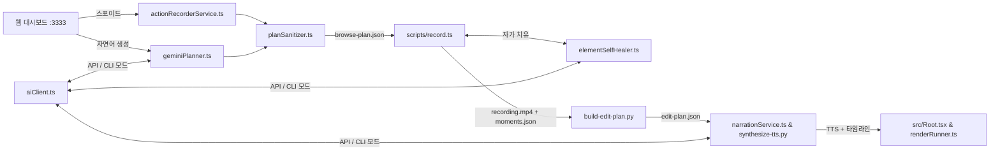

# AGENTS.md — Screen Demo Studio 아키텍처 및 엔지니어링 핵심 원칙

이 문서는 **Screen Demo Studio (`ai-screen-studio`)**의 아키텍처, 파이프라인, 그리고 AI 에이전트가 코드를 수정·검증할 때 반드시 준수해야 하는 핵심 엔지니어링 원칙을 정의합니다.
*(주의: 시스템 프롬프트 `<user_rules>` 자동 주입 시 뒷부분이 잘리지 않도록 이 문서의 전체 크기는 항상 **20KB 이하**로 유지합니다.)*

---

## 1. 프로젝트 개요 및 핵심 철학 (Core Philosophy)

* **프로젝트명**: Screen Demo Studio (`ai-screen-studio`) / **대시보드**: `http://localhost:3333` (`npm run dashboard` / `scripts/dashboard-server.ts`)
* **핵심 철학 2대 원칙**:
  1. **클릭한 대로 정확히 재현 (What You Click Is What Gets Recorded)**: 동작 감지(스포이드, `actionRecorderService.ts`)로 캡처한 클릭·우클릭·호버·드래그·타이핑·드롭다운선택·파일첨부는 재생 엔진(`scripts/record.ts`)에서 **사용자가 의도한 바로 그 요소**에 1:1로 재현되어야 합니다.
  2. **전 모듈 범용 설계 (Universal Multi-Module Design — No Single-Scenario Hacks)**: 일정관리, 전자결재, 문서관리, 게시판, 자원예약, 스마트워크, 전자우편, 사내쪽지, 위키, 주소록, 조직도 등 어떤 모듈에서도 작동하는 **범용 메커니즘**만 사용하며 특정 시나리오용 하드코딩을 금지합니다.

---

## 2. 시스템 파이프라인 및 주요 파일 구조



| 구분 | 파일 경로 | 역할 |
| :--- | :--- | :--- |
| **대시보드 서버/UI** | `scripts/dashboard-server.ts`, `dashboard/index.html`, `dashboard/style.css`, `dashboard/app.js` | 시나리오 관리/삭제, API/CLI 전환, 스포이드 감지, 대본/타임라인/컷 편집, 백그라운드 렌더링 제어 |
| **통합 AI 실행 엔진** | `src/services/aiClient.ts`, `src/services/configManager.ts`, `src/services/aiUsageTracker.ts` | **API 모드**(`@google/genai`) 및 **CLI 모드**(`agy` / `claude` / `gemini` CLI `stdin` 스트리밍) 통합 실행 및 사용량 추적 |
| **동작 감지(스포이드)** | `src/services/actionRecorderService.ts` | 실시간 브라우저에서 `click`, `rightclick`, `hover`, `dragAndDrop`, `type`, `selectOption`, `upload`, `windowBounds`/`viewport`, `targetHtml` 포착 |
| **AI 플래너 & 정제기** | `src/services/geminiPlanner.ts`, `src/services/groupwareCatalog.ts`, `src/services/planSanitizer.ts` | 자연어 시나리오 생성, 셀렉터 정규화, `targetHtml` 기반 고유 속성/텍스트 보강, 중복/오탐 이벤트 정리 |
| **브라우저 녹화 & 치유** | `scripts/record.ts`, `src/services/elementSelfHealer.ts` | Playwright 시나리오 재생, 창 크기/위치 1:1 동기화, 멀티창(`pageStack`)/모달/트리/드래그/업로드 제어 및 실시간 DOM 자가 치유 |
| **AI 대본 & 슬라이드** | `src/services/narrationService.ts`, `scripts/synthesize-tts.py`, `src/services/siteBrandService.ts`, `src/services/slideVideoComposer.ts` | Why/개념 중심 매뉴얼 대본·Edge-TTS 합성, 사이트 헤더 테마 컬러·투명 로고 추출(`data/_site_brands/<host>/`), 오프닝·통합 표지/목차 슬라이드 합성 |
| **편집/병합 & 렌더링** | `scripts/build-edit-plan.py`, `src/components/FrameMapper.ts`, `src/services/videoEditorService.ts`, `src/services/renderRunner.ts` | 줌/팬 키프레임, 타임워프 커서/줌 동기화, 구간 잘라내기/전체 통합 목차(`Master Contents`) 병합, 격리 MP4 렌더링(30/60fps) |

---

## 3. 7대 핵심 엔지니어링 원칙 (Engineering Rules)

### 원칙 1. 동작 감지(스포이드) 셀렉터 생성 및 이벤트 캡처 정밀화 (`actionRecorderService.ts`)
1. **고유 식별 속성·정확 텍스트·형제 문맥 스코핑 최우선 및 실시간 DOM 검증(`verifyAndRankCandidatesInLiveDom`)**:
   - 동적 목록/트리(`#orgUserList`, `#resSelect_resList`, `.dynatree-container`, `li.nt_li._orgUser`)에서 `:nth-of-type(n)`을 맨 앞에 두지 않고, **`id` / `name` / 고유 데이터 속성(`data-res-id`, `data-dept-id`, `data-emp-id`, `data-cmp-id`, `data-cal-id`, `data-brd-id`, `data-trgt-id`) → 정확한 텍스트/타이틀/행·트리노드 스코핑(`:text-is('...')`, `[title='...']`, `li:has(a.dynatree-title:text-is('...')) span.dynatree-expander:visible`) → 구조적 경로** 순서로 구성합니다.
   - 후보 셀렉터는 캡처 즉시 실제 DOM에 실행해 **유일 매칭(`1 of 1`) 1순위**, 첫 번째 매칭(`1 of N`) 2순위로 두고, **`matchIdx > 0`은 폐기**합니다.
2. **범용 자식 요소 핑거프린팅 및 긴 인라인 `style` 제거**:
   - 자체 `id`가 없는 `<label>`, `<a>`, `<button>` 클릭 시 자식 `<input id/name/value>`, `[data-emp-id]`, 고유 시각 클래스(`scvr\d+`, `plt_\d+`)를 추출해 `label.chkbox:has(#childId):visible` 등으로 생성하며, `targetHtml`의 60자 초과 인라인 `style`은 제거합니다.
3. **가시성 기반 중복 ID 판별(`isStableId`) 및 상태 클래스 제거**:
   - 보이는(`visible`) 요소 중 중복 ID, `/^th\d+$/i`, 메신저 동적 사원 ID는 거부하되 숨겨진 템플릿에만 동명 ID가 있는 경우(`#gapWorkSelect_searchWord`, `#_DOC_TITLE_`)는 채택합니다. 숫자로 시작하는 클래스는 `[class~='1400']`으로 변환하고 `.dynatree-expanded`, `.ui-state-*`, `.hover`, `.active`, `.focus`, `.chkbox_on`, `.rdobtn_on`, `.ico_chk_on`은 제외합니다.
4. **오탐/중복 이벤트 차단 및 에디터·드롭다운·업로드·우클릭·창 크기/HUD 보호**:
   - `<label>` 클릭 후 80ms 이내 합성 `<input>` 클릭, 커스텀 스크롤바(`mCustomScrollBox`, `mCSB_dragger`) 오탐, `Enter` `keyup` 재장전(`lastFlushedElement`), 양식 카드(`li.aw_li`) 중복 `hover`, 자기 드래그(`isSameOrSelfDropTarget`)를 차단합니다.
   - 리치 에디터 기본 양식은 `extractTypedDeltaFromTemplate()`로 추가 입력분만 추출하고, `<select>`는 `selectOption`, 파일 첨부는 `upload`(`data/_uploads/` 보존), 우클릭은 `rightclick`으로 포착하며, 종료 시 `windowBounds`/`viewport` 저장 및 HUD(`#__sd_recorder_hud`) 자동 회피를 수행합니다.

### 원칙 2. 플랜 정제기(`planSanitizer.ts`) 보존 및 정규화 규칙
1. **`recordedByEyedropper: true` 액션 존중 및 최상위 태그 기준 `targetHtml` 보강**:
   - 사용자가 직접 시연한 액션(초반 로그인 시연 포함)을 임의로 삭제하거나 덮어쓰지 않으며, `targetHtml` 속성 추출 시 반드시 최상위 여는 태그(`outerOpenTag`)에서만 `id`/`title`을 추출하고 HTML 엔티티를 디코딩합니다.
2. **따옴표 인식 셀렉터 분리(`splitSelectorCandidates`) 및 동적 생성 항목 우선순위**:
   - 속성값/텍스트 내부에 콤마(`,`)가 포함된 셀렉터가 깨지지 않도록 `splitSelectorCandidates`를 사용하며, 재녹화 시마다 DB ID(`data-book-id`, `data-work-box-id`, `data-wks-id` 등)가 바뀌는 동적 항목은 **Tier 1(이름/제목 텍스트 및 행 스코핑) → Tier 2(고유 엔티티 ID)** 순서로 배치합니다.

### 원칙 3. 브라우저 녹화 엔진 정밀 제어 (`scripts/record.ts`)
1. **선제적 DB 스크래핑 및 스포이드 시나리오 임의 개입 금지**:
   - `case "type":`에서 검색어를 가짜 텍스트로 오판해 화면 첫 번째 항목을 미리 스크래핑하거나 후속 액션을 덮어쓰지 않으며, 스포이드(`recordedByEyedropper: true`) 시나리오에서는 가짜 텍스트 자동 주입 등 보조 로직 개입을 차단합니다.
2. **창 위치/해상도 1:1 재현, 자식 팝업(`pageStack`) 보존 및 푸시 알림창 차단**:
   - 기록된 `windowBounds`와 `viewport`를 `--window-position`/`--window-size` 및 `recordVideo.size`에 1:1 반영하고, `window.open` 팝업은 실제 자식 팝업(`pageStack`)에서 실행 후 닫아 부모 창의 SPA/DOM 상태를 보존하며, 백그라운드 푸시 알림창(`homGwPushPopup`, `notiPopup`)은 즉시 차단합니다.
3. **모달 스코핑, 닫힘 감지, 원자적 타겟 보호, 에디터 이어쓰기**:
   - `.ui-dialog:visible` 모달이 열려 있을 때는 최상단 모달 내부를 우선 탐색하되 달력/시간 피커·자동완성 팝오버는 루트 탐색을 허용하며, 모달 버튼 클릭 후 요소/모달이 사라지면(`waitForModalToCloseIfTriggered`) 닫힘 완료를 대기합니다.
   - 원자적 컨트롤(`a`, `button`, `label`, `input`, `.Selected` 등)은 내부 자식으로 재탐색하지 않으며(`resolveAtomicTarget`), 기본 템플릿이 있는 리치 에디터는 커서를 본문 끝으로 이동(`moveCaretToEnd`)해 이어 씁니다.

### 원칙 4. 통합 AI 실행 엔진 (`API 모드 / CLI 모드`) 및 실시간 자가 치유 (`aiClient.ts`, `elementSelfHealer.ts`)
1. **API 모드(`api`) & 로컬 CLI 모드(`cli`) 이원화 지원**:
   - 대시보드 상단 헤더(`[🔌 API | 💻 CLI]`), 나레이션 툴바, `#pill-ai` 모달에서 실행 모드를 즉시 전환할 수 있으며 `.env`(`AI_MODE`, `AI_CLI_PROVIDER`, `AI_CLI_MODEL`)에 영속화됩니다.
   - **CLI 모드(`cli`)**: PC에 로그인된 `Antigravity CLI (agy.exe --input-format stream-json --output-format stream-json -p=)` 또는 `Claude Code CLI (claude.exe -p --output-format json)`에 `stdin` 파이프로 프롬프트를 전달하여 명령줄 길이 제한 없이 대본 생성·시나리오 생성·실시간 자가 치유를 수행합니다(API 키 불필요 · 요금 ₩0).
2. **무추측 원칙 (Zero-Guessing Policy) 및 단일 패스 자가 치유 완료 (강제 재녹화 생략)**:
   - `LiveDOMCandidate` 목록에 없는 가상 ID를 추측하지 않으며, 녹화 중 자가 치유가 발생하면 치유된 셀렉터를 `browse-plan.json`에 즉시 영구 반영하고 **재녹화(2-Pass) 없이 현재 녹화본으로 즉시 후가공을 완료**합니다(탐색 대기 구간은 대시보드 `✂️ 구간 잘라내기`로 편집 가능).

### 원칙 5. AI 내레이션 대본, 사이트 맞춤형 마스터 슬라이드(`Contents`) 및 타임워프 싱크 (`narrationService.ts`, `siteBrandService.ts`, `slideVideoComposer.ts`, `FrameMapper.ts`)
1. **기능 개념·역할('What & Why') 해설 및 녹화 종료 시 오프닝 슬라이드+음성 즉시 합성**:
   - 메뉴/기능 진입 시 그 메뉴가 무엇인지(개념·역할)와 업무적 목적(Why)을 함께 해설하며, 녹화 종료 시 AI 대본·목차(`introToc`)·Edge-TTS 음성을 생성하고 `recording.mp4` 앞단(`0:00~introDurationMs`)에 오프닝 슬라이드 영상을 즉시 합성(`recording.body.mp4`/`moments.body.json` 순수 본문 보존)합니다.
2. **URL별 사이트 마스터 슬라이드 디자인 규칙 및 중복 오버레이/홀드 금지**:
   - `siteBrandService.ts`는 상단 헤더 픽셀 히스토그램에서 실제 사이트 테마 컬러(예: `#FF9600`)와 좌측 상단 로고(배경 투명화 `logo.png`)를 추출해 `data/_sites/<host>/`에 마스터로 캐싱합니다.
   - 개별 시나리오 오프닝 슬라이드는 좌측 일러스트 없이 **전체 화면 `Contents` 세부내용 목차 전용 슬라이드**로 구성하며(우측 상단에 사이트 로고·매뉴얼 배지 배치), 버전 정보(`Ver 7.5`)나 구어체 대본(`"이번 시간에는~"`)은 제거합니다.
   - 여러 시나리오 병합(`mergeRenderedVideos`) 시 **`[첫장: 그룹웨어 사용 매뉴얼 표지 슬라이드] → [둘째장: 각 시나리오의 큰 타이틀 슬라이드(Master Contents)] → ([시나리오 세부내용 Contents 슬라이드 → 본문 영상 시작] × N개)`** 순서로 결합합니다.
   - 이미 영상 앞단에 슬라이드가 합성(`introBakedIntoVideo: true`)된 경우 플레이어 위 HTML 오버레이(`#live-intro-toc-overlay`)나 `IntroTocOverlay.tsx`를 중복 표시하지 않으며, 첫 구간(`i === 0`)에는 추가 홀드(`autoHoldMs = 0`)를 부여하지 않습니다.
3. **타임워프(`TimeRegion`) 구간 연장 및 `compTimeMs` 기준 커서/줌 매핑**:
   - 본문 구간에서 음성 길이가 동작 간격보다 길 때 부족한 시간(`autoHoldMs` + `extraHoldMs`)만큼 화면을 홀드(`editPlan.timeRegions`)하며, 가상 커서·카메라 줌·효과음은 **최종 합성 타임라인(`compTimeMs` / `compFrame`)** 기준으로 동기화합니다.

### 원칙 6. 시나리오별 완전 격리 백그라운드 렌더링 및 비디오 편집 (`renderRunner.ts`, `src/Root.tsx`, `videoEditorService.ts`, `dashboard/`)
1. **공용 `public/recording.mp4` 및 `src/Root.tsx` 덮어쓰기 절대 금지 & 원본 해상도 비율 일치**:
   - `src/Root.tsx`는 `calculateMetadata`를 통해 전달된 시나리오별 데이터만으로 `fps`, `durationInFrames`, `width`, `height`(원본 녹화 해상도 비율)를 동적 결정하며, `renderRunner.ts`는 격리 경로(`renders/<slug>-<taskId>/recording.mp4`)에 하드링크로 스테이징한 뒤 종료 즉시 정리합니다.
2. **비간섭 대시보드 UI/SSE 분리, 고속 렌더링(30/60fps) 및 안전 파일 교체**:
   - 우측 하단 플로팅 도크(`#background-render-dock`)와 전용 SSE 이벤트로 비간섭 렌더링을 수행하고, 비디오 잘라내기/복원/삭제 시 `<video>` 스트림 잠금을 먼저 해제(`releaseVideoFileLock`)하고 `replaceFileSafeWindows`를 사용합니다.

### 원칙 7. 검증 및 운영 수칙 (Operational & Verification Rules)
1. **수정 전 반드시 현재 상황 보고 및 사용자 승인 후 실행 (Report First & Ask Before Modifying)**:
   - 어떤 질문이나 요청을 받더라도 **절대로 먼저 코드·설정·영상 파일을 임의로 수정하지 않습니다.**
   - 반드시 **(1) 현재 상황 및 원인 분석 보고 → (2) 수정 방안 및 변경 대상 안내 → (3) "수정할까요?" 여부 확인** 절차를 거친 뒤, 사용자의 명시적 승인이 떨어졌을 때만 수정을 실행합니다.
2. **대시보드 서버 에이전트 직접 실행 절대 금지**: `npm run dashboard`나 `scripts/dashboard-server.ts`는 항상 사용자가 직접 실행합니다.
3. **엔진/정제기 버그 우회용 `browse-plan.json` 임시방편 조작 금지**: 반드시 `actionRecorderService.ts`, `planSanitizer.ts`, `scripts/record.ts` 로직을 수정합니다.
4. **백그라운드 데몬 실행 금지 (`IsDaemon: false`)** 및 **프레임 단위 시각 검증**: 녹화/렌더링 테스트 후 프레임을 추출해 눈으로 확인하고 임시 이미지는 즉시 삭제합니다.

---

## 4. 자주 쓰는 실행 명령어

```bash
# 1. 특정 시나리오 브라우저 녹화 실행 (주의: npm run dashboard 는 에이전트가 직접 실행 금지)
npx tsx scripts/record.ts <slug> --headless
npx tsx scripts/record.ts <slug> --headed

# 2. 줌/팬 편집 플랜 단독 재생성
python scripts/build-edit-plan.py data/<slug>/

# 3. TypeScript 전체 타입 검사 및 프론트엔드 문법 검사
npx tsc --noEmit
node -c dashboard/app.js
```

---

## 5. 현재 프로젝트 상태 및 다음 세션 인수인계 (Handoff Status)

* **현재 완료 상태**:
  1. 스포이드 1:1 정밀 캡처(`verifyAndRankCandidatesInLiveDom`, 트리/형제 문맥 스코핑, 자식 핑거프린팅, 리치 에디터 템플릿 보존, `<select>` `selectOption`, 파일 업로드 `upload`, 우클릭 `rightclick`, 커스텀 스크롤바 오탐 차단, 창 크기/위치 `windowBounds` 동기화, HUD 자동 회피) 및 플랜 정제기(`planSanitizer.ts`) 구축 완료.
  2. 멀티창 팝업(`pageStack`) 보존, 모달 닫힘 자동 감지(`waitForModalToCloseIfTriggered`), 초반 로그인 시연 보존, 동적 생성 항목 텍스트 우선 매칭 완료 (`taskboard` 324모멘트 / 442.4초 전 구간 자가 치유 0건 클린 녹화 검증 완료).
  3. **대시보드 `🔌 API 모드 / 💻 CLI 모드` 원클릭 전환 시스템 (`src/services/aiClient.ts`)** 구축 완료 (`Antigravity CLI` · `Claude Code CLI` · `Gemini CLI` `stdin` 스트리밍 연동).
  4. 시나리오별 완전 격리 백그라운드 렌더링(`renderRunner.ts`), 비간섭 플로팅 도크(`#background-render-dock`), `30fps/60fps` 선택, 구간 잘라내기(`✂️`)/챕터 합치기(`🔗`)/시나리오 삭제(`🗑️`) 완료.
  5. **전수조사 안정화 패치 및 병합 오프닝 슬라이드 고도화 완료**:
     - 병합 시나리오(`first` 등) 대본 저장 시 앞단 2장(표지 + 통합목차) 고속 재합성(`fastApplyMergedScenarioNarration`), `"안녕하십니까."` 하드코딩 제거, 챕터 전환 브릿지 안내 멘트 자동 삽입 완료.
     - `gw.bc.ac.kr` / `gwdev.bc.ac.kr` 정품 오렌지 테마(`#FF9600`) 및 로고 동기화, 전 시나리오 `compStartMs`/`compEndMs` 무결성 보장, 대본 저장 API 최신 상태 반환, 컷 편집/복원 시 `rendered.base.mp4` 캐시 정합성 패치 완료.

* **🚀 다음 세션 연속 작업 리스트 (1번부터 순서대로 진행 후 매 단계 사용자에게 보고)**:
  - **[1번] 병합 시나리오(`first` 등) 전 구간 본문 대본 재합성 & 챕터 바로가기 탭**:
    - `slideVideoComposer.ts`의 `fastApplyMergedScenarioNarration()`에서 앞 2장뿐만 아니라 본문 대본(`cues[2..N]`) 수정 시에도 전체 병합 영상의 해당 타임스탬프 오디오에 새 TTS 음성이 즉시 반영되도록 개선 + `[🔄 원본 챕터로 병합본 재빌드]` 버튼 제공.
    - 대본 편집기 상단에 `📑 챕터 이동: [전체] [01 로그인] [02 웹 메신저] [03 문서관리] [04 태스크보드] [05 스페이스]` 탭을 추가해 클릭 시 해당 챕터 대본 스크롤 및 영상 위치 즉시 이동.
  - **[2번] 시나리오 라이브러리 도메인별 그룹화 및 도메인 필터링**:
    - `scenarioManager.ts` 및 `dashboard/app.js`에서 시나리오별 도메인/사이트 브랜드(`bc.ac.kr`, `naonsoft.com` 등)를 추출해 도메인별 필터 칩 및 접기/펼치기 그룹 헤더(로고·테마 컬러 표시)로 분류 출력 (`_site_brands`, `_uploads` 등 시스템 폴더 제외).
  - **[3번] 멀티트랙 타임라인 분리 + `Ctrl + 마우스 휠` 확대/축소 + 타임라인 ↔ 대본 양방향 점프**:
    - 단일 바(`#timeline-visual-bar`)에 겹쳐 있던 요소들을 **① 시간 눈금자(Ruler) / ② 🔍 줌 & ⏸ 홀드 트랙 / ③ 🎯 클릭·동작 마커 트랙 / ④ 🎙️ AI 대본 트랙** 4단 레인으로 분리.
    - `Ctrl + 마우스 휠` (및 배율 버튼 `1x~20x`)로 커서 기준 타임라인 확대/축소 및 가로 스크롤 지원(확대 시 대본 블록 내부에 텍스트 표시).
    - 타임라인의 `🎙️ 대본 블록` 클릭 시 영상 시점 이동과 동시에 하단 `🎙️ AI 나레이션 대본` 탭의 해당 대본 줄로 자동 스크롤·하이라이트·포커스 이동 (양방향 연동).
  - **[4번] 사이트 브랜드(테마 색상·로고·기관명) 상위 도메인 자동 상속 및 대시보드 설정 UI**
  - **[5번] 플레이어 상태 배지 명확화 및 미반영 대본 알림 배너**
  - **[6번] 디스크 용량 최적화 (하드링크 적용 및 임시/캐시 파일 원클릭 정리)**
  - **[7번] 통합 헬스체크(`npm run doctor`) 스크립트 추가**
