# AGENTS.md — Screen Demo Studio 아키텍처 및 엔지니어링 핵심 원칙

이 문서는 **Screen Demo Studio (`ai-screen-studio`)**의 아키텍처, 파이프라인, 그리고 AI 에이전트가 코드를 수정·검증할 때 반드시 준수해야 하는 핵심 엔지니어링 원칙을 정의합니다.
*(주의: 시스템 프롬프트 `<user_rules>` 자동 주입 시 뒷부분이 잘리지 않도록 이 문서의 전체 크기는 항상 **20KB 이하**로 유지합니다.)*

---

## 1. 프로젝트 개요 및 핵심 철학 (Core Philosophy)

* **프로젝트명**: Screen Demo Studio (`ai-screen-studio`)
* **대시보드 주소**: `http://localhost:3333` (`npm run dashboard` / `scripts/dashboard-server.ts`)
* **핵심 철학 2대 원칙**:
  1. **클릭한 대로 정확히 재현 (What You Click Is What Gets Recorded)**:
     사용자가 동작 감지(스포이드, `actionRecorderService.ts`)로 직접 클릭·우클릭·호버·드래그·타이핑·파일첨부한 액션은 재생 엔진(`scripts/record.ts`)에서 **사용자가 의도한 바로 그 요소**에 1:1로 정확히 재현되어야 합니다. 엉뚱한 첫 번째 행을 클릭하거나 배경 버튼을 오클릭하는 일을 원천 차단합니다.
  2. **전 모듈 범용 설계 (Universal Multi-Module Design — No Single-Scenario Hacks)**:
     일정관리, 전자결재, 문서관리, 게시판, 자원예약, 스마트워크, 전자우편, 사내쪽지, 위키, 주소록, 조직도 등 그룹웨어의 어떤 모듈에서 시나리오가 생성되더라도 동일하게 작동하는 **범용 메커니즘**으로 해결해야 합니다. 특정 시나리오 한두 개만 통과시키기 위한 하드코딩이나 임시방편 땜질을 엄격히 금지합니다.

---

## 2. 시스템 파이프라인 및 주요 파일 구조

```mermaid
graph LR
    UI[웹 대시보드 :3333] -->|동작 감지 스포이드| Recorder[src/services/actionRecorderService.ts]
    UI -->|자연어 시나리오 생성| Planner[src/services/geminiPlanner.ts]
    Recorder --> Sanitizer[src/services/planSanitizer.ts]
    Planner --> Sanitizer
    Sanitizer -->|browse-plan.json| Runner[scripts/record.ts]
    Runner <-->|실시간 복구 / DB 폴백| Healer[src/services/elementSelfHealer.ts]
    Runner -->|recording.mp4 + moments.json| EditPlan[scripts/build-edit-plan.py]
    EditPlan -->|edit-plan.json| Narration[src/services/narrationService.ts & scripts/synthesize-tts.py]
    Narration -->|TTS MP3 + 자막/타임라인| Remotion[src/Root.tsx & src/services/renderRunner.ts]
```



| 구분 | 파일 경로 | 역할 |
| :--- | :--- | :--- |
| **대시보드 서버/UI** | `scripts/dashboard-server.ts`, `dashboard/index.html`, `dashboard/style.css`, `dashboard/app.js` | 시나리오 관리/삭제, 스포이드 동작 감지, 대본/타임라인/컷 편집, 녹화 및 비간섭 백그라운드 렌더링 제어 |
| **동작 감지(스포이드)** | `src/services/actionRecorderService.ts` | 실시간 브라우저에서 사용자의 `click`, `rightclick`, `hover`, `dragAndDrop`, `type`, `upload` 및 `targetHtml` 포착 |
| **AI 플래너 & 카탈로그** | `src/services/geminiPlanner.ts`, `src/services/groupwareCatalog.ts` | 자연어 프롬프트 기반 시나리오 생성 및 그룹웨어 모듈별 표준 DOM 규격 제공 |
| **플랜 정제기** | `src/services/planSanitizer.ts` | 셀렉터 문법 정규화, `targetHtml` 기반 고유 속성/텍스트 보강, 중복 타이핑/호버 및 오탐 드래그 정리 |
| **브라우저 녹화 엔진** | `scripts/record.ts` | Playwright 기반 시나리오 재생, 멀티창(`pageStack`)/모달/트리/드래그/업로드 제어, `recording.mp4` & `moments.json` 생성 |
| **실시간 자가 치유** | `src/services/elementSelfHealer.ts` | 런타임 요소 탐색 실패 시 실시간 DOM 후보군 + 화면 캡처 기반 멀티모달 복구 |
| **AI 대본 & TTS 합성** | `src/services/narrationService.ts`, `scripts/synthesize-tts.py`, `src/components/NarrationTrack.tsx` | 도입부 요약·Why 중심 매뉴얼 대본 생성(4종 스타일), 증분 Edge-TTS 합성 및 타임워프(`TimeRegion`) 산출 |
| **편집/병합 & 격리 렌더링** | `scripts/build-edit-plan.py`, `src/components/FrameMapper.ts`, `src/components/SyntheticCursor.tsx`, `src/services/videoEditorService.ts`, `src/services/renderRunner.ts` | 줌/팬 키프레임, 타임워프 커서/줌 동기화, 구간 잘라내기/챕터 무손실 병합, 시나리오별 백그라운드 격리 MP4 렌더링(30/60fps) |

---

## 3. 7대 핵심 엔지니어링 원칙 (Engineering Rules)

### 원칙 1. 동작 감지(스포이드) 셀렉터 생성 및 이벤트 캡처 정밀화 (`actionRecorderService.ts`)
1. **고유 식별 속성·정확 텍스트 최우선 및 캡처 시점 실시간 DOM 검증(`verifyAndRankCandidatesInLiveDom`)**:
   - 동적 목록이나 트리(`#orgUserList`, `#resSelect_resList`, `.dynatree-container`, `li.nt_li._orgUser` 등)에서 `:nth-of-type(n)` 같은 순서 의존 셀렉터를 맨 앞에 두지 않습니다.
   - 반드시 **`id` / `name` / 고유 데이터 속성(`data-res-id`, `data-dept-id`, `data-emp-id`, `data-cmp-id`, `data-cal-id`, `data-brd-id`, `data-trgt-id`) → 정확한 텍스트/타이틀/행 스코핑(`:text-is('...')`, `[title='...']`, `li:has-text('...')`) → 구조적 경로(`:nth-of-type`)** 순서로 구성합니다.
   - 생성된 후보 셀렉터는 캡처 즉시 실제 DOM에 실행하여 **유일 매칭(`1 of 1`) 후보를 1순위**, 첫 번째 매칭(`1 of N`)을 2순위로 두고, **`matchIdx > 0`(.first()가 다른 요소를 클릭하게 되는 후보)은 즉시 폐기**합니다.
2. **범용 자식 요소 핑거프린팅 및 긴 인라인 `style` 제거**:
   - 자체 `id`가 없는 `<label>`, `<a>`, `<button>` 클릭 시 내부 자식 `<input id="..." name="..." value="...">`, 자식 `[data-emp-id]`, 고유 시각 클래스(`scvr\d+`, `plt_\d+`)를 추출해 `label.chkbox:has(#childId):visible`, `label.rdobtn:has(input[name='...'][value='...']):visible` 형태로 생성합니다(공통 `.ico_hide`/`.ico_info`나 무스코프 `[name='...']` 단독 생성은 금지).
   - `targetHtml` 추출 시 60자를 초과하는 인라인 `style="..."`은 사전 제거하여 핵심 속성 잘림을 방지합니다.
3. **가시성 기반 중복 ID 판별(`isStableId`) 및 일시적 런타임 상태 클래스 제거**:
   - 화면에 보이는(`visible`) 요소 중 중복 선언된 ID, 테이블 헤더 번호(`/^th\d+$/i`), 메신저 동적 사원 ID(`wmOrgList_orgTreeList_...`)는 거부하되, 숨겨진 템플릿에만 동명 ID가 있고 실제 보이는 요소가 유일한 경우(`#gapWorkSelect_searchWord`)나 GAPP 문서 제목(`#_DOC_TITLE_`)은 정상 채택합니다.
   - 숫자로 시작하는 클래스명은 `[class~='1400']` 속성 선택자로 변환하고, `.dynatree-expanded`, `.ui-state-*`, `.hover`, `.active`, `.focus`, `.chkbox_on`, `.rdobtn_on`, `.ico_chk_on` 등 상태 클래스는 셀렉터에서 제외합니다.
4. **오탐/중복 이벤트 원천 차단 및 리치 에디터·업로드·우클릭·HUD 보호**:
   - **체크박스 합성 더블클릭 차단**: `<label>` 클릭 직후 80ms 이내 발생하는 합성 `<input>` 클릭을 차단합니다.
   - **중복 타이핑/호버/자기 드래그 차단**: `Enter` `keyup`이나 비문자 제어 키로 인한 `type` 재장전 차단(`lastFlushedElement`), 양식 카드(`li.aw_li`) 중복 `hover` 차단, 트리 노드 미세 흔들림으로 인한 자기 자신 `dragAndDrop` 오탐 차단(`isSameOrSelfDropTarget`)을 유지합니다.
   - **리치 에디터 템플릿 보존**: `div.se-contents`, `contenteditable`, `.ProseMirror`에 기본 양식 문구가 있을 때는 `extractTypedDeltaFromTemplate()`로 추가 입력분만 추출하고, 다른 프레임 클릭 및 `submit`/`beforeunload` 시 모든 프레임의 타이핑 버퍼를 즉시 플러시(`flushAllFrames`)합니다.
   - **파일 첨부(`upload`) & 우클릭(`rightclick`)**: `<input type="file">` 변경 및 드래그 드롭 파일을 `data/_uploads/`에 보존하고 직전 버튼 클릭을 `upload` 액션으로 승격하며(`C:\fakepath\` 가짜 타이핑 차단), 우클릭(`contextmenu`)은 `rightclick` 액션으로 정확히 포착합니다.
   - **스포이드 HUD(`#__sd_recorder_hud`) 가림 방지**: 하단 버튼 아래에 웹페이지 인터랙티브 요소가 감지되면 빈 모서리로 자동 회피(Auto-Dodge)합니다.

### 원칙 2. 플랜 정제기(`planSanitizer.ts`) 보존 및 정규화 규칙
1. **`recordedByEyedropper: true` 액션 존중 및 최상위 태그 기준 `targetHtml` 보강**:
   - 사용자가 직접 시연한 액션(초반 로그인 시연 포함)을 임의로 삭제하거나 엉뚱한 셀렉터로 덮어쓰지 않습니다.
   - `targetHtml` 속성 추출 시 반드시 최상위 여는 태그(`outerOpenTag`)에서만 `id`/`title`을 추출하여 자식 `<i title="숨김 부서">`나 `data-menu-id`가 가짜 `#id`/`[title]`로 오염되는 일을 방지하고, HTML 엔티티(`&nbsp;`, `&amp;` 등)를 디코딩합니다.
2. **따옴표 인식 셀렉터 분리(`splitSelectorCandidates`) 및 동적 생성 항목 우선순위**:
   - 속성값/텍스트 내부에 콤마(`,`)가 포함된 셀렉터가 깨지지 않도록 반드시 `splitSelectorCandidates`를 사용합니다.
   - 생성 후 삭제되어 재녹화 시마다 DB ID(`data-book-id` 등)가 바뀌는 동적 항목은 **Tier 1(이름/제목 텍스트 및 행 스코핑) → Tier 2(고유 엔티티 ID)** 순서로 배치하여 ID가 바뀌어도 동일한 이름의 항목을 정확히 클릭합니다.
   - 비(非)양식카드 `btn_write` 앞에 허위 양식 카드 호버를 주입하지 않으며, 레거시 플랜의 중복 `[type → hover → type]` 및 자기 자신 트리 드래그 시퀀스는 자동 정리합니다.

### 원칙 3. 브라우저 녹화 엔진 정밀 제어 (`scripts/record.ts`)
1. **선제적 DB 스크래핑 및 스포이드 시나리오 임의 개입 금지**:
   - `case "type":`에서 사용자의 검색어를 가짜 텍스트로 오판해 화면 첫 번째 항목을 미리 스크래핑하거나 후속 액션을 덮어쓰지 않습니다. 실시간 DB 스크래핑은 오직 후속 클릭/호버 대상 탐색이 1차 실패했을 때만 `trySelfHealAction` 내부에서 On-Demand로 가동합니다.
   - 스포이드(`recordedByEyedropper: true`) 시나리오에서는 가짜 텍스트 자동 주입이나 드롭다운 첫 번째 항목 강제 클릭 등 AI 플랜용 보조 로직이 개입하지 않도록 차단하며, 로그인 시연으로 시작하는 시나리오(`startsWithExplicitLogin`)는 `auth.json` 미주입 상태로 로그인 화면부터 재현합니다.
2. **실제 자식 팝업(`pageStack`) 보존 및 푸시 알림창 하이재킹 차단**:
   - `window.open` 및 `target="_blank"` 팝업을 부모 창 `location.href`에 덮어쓰거나 팝업 종료 시 부모 창을 강제 리로드하지 않고, 실제 자식 팝업(`pageStack`)에서 실행 후 닫아 부모 창의 SPA/DOM 상태를 100% 보존합니다.
   - 쪽지/메일 발송 직후 뜨는 백그라운드 푸시 알림창(`homGwPushPopup`, `notiPopup` 등)이 포인터를 가로채지 않도록 즉시 차단하고, 녹화 비디오는 항상 메인 창(`pageStack[0]`) 기준으로 보존합니다.
3. **모달 스코핑, 원자적 타겟 보호, 에디터 이어쓰기, 업로드/우클릭 제어**:
   - `.ui-dialog:visible` 모달이 열려 있을 때는 최상단 활성 모달 내부를 우선 탐색하되, `body` 직하단 달력/시간 피커·자동완성 팝오버는 루트 탐색을 허용합니다.
   - 매칭된 요소가 원자적 컨트롤(`a`, `button`, `label`, `input`, `.Selected` 등)이면 내부 자식으로 재탐색하지 않으며(`resolveAtomicTarget`), 닫힌 커스텀 드롭다운 내부 항목 클릭 시 상위 트리거를 먼저 자동으로 엽니다.
   - 기본 템플릿이 있는 리치 에디터는 내용을 지우지 않고 커서를 본문 끝으로 이동(`moveCaretToEnd`)해 줄바꿈 후 이어 쓰며, 우클릭(`rightclick`) 전에는 뷰포트 스크롤(`scrollTargetIntoViewIfNeeded`)을 수행합니다.

### 원칙 4. 실시간 AI 자가 치유 (`elementSelfHealer.ts`)
1. **무추측 원칙 (Zero-Guessing Policy) 및 2-Pass 클린 재녹화**:
   - 화면에서 실시간 추출한 `LiveDOMCandidate` 목록에 존재하지 않는 가상 ID를 추측하여 생성하지 않으며, 1차 녹화 중 자가 치유가 발생해 대기 공백이 생겼다면 치유된 셀렉터를 반영한 뒤 자동으로 `--clean-pass` 재녹화를 수행합니다.

### 원칙 5. AI 내레이션 대본, 정속 TTS 및 타임워프 4대 트랙 싱크 (`narrationService.ts`, `synthesize-tts.py`, `FrameMapper.ts`)
1. **오프닝 개요(`0.2s`), 'Why & Effect' 매뉴얼 해설 및 예시값 범용화**:
   - 영상 시작 직후(`0.2s`) 전체 매뉴얼 개요를 안내하고, 각 단계는 커서가 이미 보여주는 단순 버튼 낭독(How)이 아니라 **업무적 목적·이유·기능적 효과(Why & Effect)**를 해설합니다(시나리오별 문구 하드코딩 금지).
   - `'16일'`, `'회의실'`, `'테스트'` 같은 구체적 예시 입력값은 그대로 읽지 않고 문맥에 맞는 자연스러운 범용 가이드 어휘(`등록할`, `검색할`, `담당할` 등)로 안내합니다.
   - 4가지 스타일(`manual`, `friendly`, `presentation`, `compact`)을 지원하며, 대본을 강제로 배속(`+35%`) 재합성하지 않고 선택된 기본 속도로 증분(Incremental) TTS 합성합니다.
2. **타임워프(`TimeRegion`) 구간 연장 및 `compTimeMs` 기준 커서/줌 매핑**:
   - 음성 길이가 원본 동작 간격보다 길 때 부족한 시간(`autoHoldMs` + 수동 `extraHoldMs`)만큼 동작 완료 직후 화면을 홀드(`editPlan.timeRegions`)합니다.
   - 이때 가상 마우스 커서(`SyntheticCursor.tsx`), 카메라 줌(`CameraTransform.tsx`), 효과음(`SoundEffects.tsx`)은 역변환된 원본 비디오 시간(`videoTimeMs`)이 아니라 **최종 합성 타임라인(`compTimeMs` / `compFrame`, `videoFrameToCompFrameExact`)** 기준으로 동작하여, 홀드 구간 동안 커서나 줌이 슬로우모션으로 기어가거나 순간이동하는 현상을 원천 차단합니다.

### 원칙 6. 시나리오별 완전 격리 백그라운드 렌더링 및 비디오 편집 (`renderRunner.ts`, `src/Root.tsx`, `videoEditorService.ts`, `dashboard/`)
1. **공용 `public/recording.mp4` 및 `src/Root.tsx` 덮어쓰기 절대 금지**:
   - 녹화(`scripts/record.ts`), 컷 편집(`videoEditorService.ts`), 렌더링(`renderRunner.ts`) 중 어떤 단계에서도 `src/Root.tsx`나 공용 `public/recording.mp4`를 수정·생성하지 않습니다.
   - `src/Root.tsx`는 Remotion `calculateMetadata={({ props }) => ...}`를 통해 `--props`로 전달된 시나리오별 데이터만으로 `fps`와 `durationInFrames`를 동적 결정하며, `renderRunner.ts`는 작업별 격리 경로(`renders/<slug>-<taskId>/recording.mp4`)에 NTFS 하드링크(`fs.linkSync`)로 스테이징한 뒤 종료 즉시 자동 정리합니다.
2. **비간섭 대시보드 UI/SSE 분리 및 고속 렌더링(30/60fps)**:
   - 렌더링 시작/완료 시 강제로 탭을 전환(`switchTab`)하거나 현재 선택된 시나리오(`selectedScenario`)를 가로채지 않으며, 우측 하단 플로팅 도크(`#background-render-dock`)와 전용 SSE 이벤트(`render-snapshot`, `render-progress`, `render-status`)로 표시하여 렌더링 중 다른 시나리오 스포이드 캡처·녹화·편집을 동시에 병행할 수 있도록 유지합니다.
   - `@remotion/bundler` 영구 번들 캐시(`node_modules/.cache/screen-demo-remotion-bundle`) 재사용 및 **`30fps(기본 고속)` / `60fps(고품질)`** 선택 옵션(`scaleEditPlanForFps`)을 유지합니다.
3. **Windows 파일 잠금(`EPERM`) 안전 처리 및 챕터 병합/삭제**:
   - 비디오 구간 잘라내기(`cutVideoSegment`), 복원(`restoreVideoBackup`), 시나리오 삭제(`DELETE /api/scenarios/:slug`) 실행 시 브라우저 `<video>` 스트림 잠금을 먼저 해제(`releaseVideoFileLock`)하고 백엔드 안전 교체(`replaceFileSafeWindows`)를 사용합니다.
   - 렌더링된 챕터 영상 합치기(`mergeRenderedVideos`)는 동일 규격(해상도/FPS)일 때 FFmpeg `-c copy` 무손실 병합을 우선 수행하고 통합 타임라인/대본을 함께 생성합니다.

### 원칙 7. 검증 및 운영 수칙 (Operational & Verification Rules)
1. **대시보드 서버 에이전트 직접 실행 절대 금지**:
   - 에이전트가 `npm run dashboard`나 `scripts/dashboard-server.ts`를 직접 실행하면 크롬 창 표시 오류나 포트 충돌이 발생하므로 **대시보드 서버 시작은 항상 사용자가 직접 수행**합니다.
2. **엔진/정제기 버그 우회용 `browse-plan.json` 임시방편 조작 금지**:
   - 셀렉터나 재생 버그를 통과시키기 위해 `data/<slug>/browse-plan.json`만 수동으로 고쳐 눈가림하지 말고 반드시 `actionRecorderService.ts`, `planSanitizer.ts`, `scripts/record.ts` 로직을 수정합니다(단, 사용자가 명시적으로 특정 시나리오 데이터 수정을 요청한 경우는 예외).
3. **백그라운드 데몬 실행 금지 (`IsDaemon: false`)**:
   - 명령어 실행 시 `IsDaemon: true`로 백그라운드 프로세스를 띄우지 않습니다.
4. **프레임 단위 시각 검증 (Visual Frame Verification)**:
   - 녹화/렌더링 테스트 후에는 영상에서 프레임을 추출해 체크박스 선택, 팝업 닫힘, 입력값 반영, 커서/자막 상태를 눈으로 확인하고 검증용 임시 이미지는 즉시 삭제합니다.

---

## 4. 자주 쓰는 실행 명령어

```bash
# 1. 특정 시나리오 브라우저 녹화 실행 (주의: npm run dashboard 는 에이전트가 직접 실행 금지)
npx tsx scripts/record.ts <slug> --headless
npx tsx scripts/record.ts <slug> --headed

# 2. 줌/팬 편집 플랜 단독 재생성
python scripts/build-edit-plan.py data/<slug>/

# 3. TypeScript 전체 타입 검사 및 프론트엔드 문법 검사
npx tsc --noEmit
node -c dashboard/app.js
```

---

## 5. 현재 프로젝트 상태 및 다음 세션 인수인계 (Handoff Status)

* **현재 완료 상태**:
  1. 스포이드 1:1 정밀 캡처(`verifyAndRankCandidatesInLiveDom`, 자식 핑거프린팅, 리치 에디터 템플릿 보존, 파일 업로드 `upload`, 우클릭 `rightclick`, HUD 자동 회피) 및 플랜 정제기(`planSanitizer.ts`) 구축 완료.
  2. 멀티창 팝업(`pageStack`) 보존, 초반 로그인 시연 보존, 동적 생성 항목 텍스트 우선 매칭 완료.
  3. 'Why & Effect' 매뉴얼 대본 생성, 증분 정속 TTS 합성, `compTimeMs` 기반 타임워프(`TimeRegion`) 4대 트랙(비디오·줌·커서·자막) 동기화, 실시간 구간 늘리기/잘라내기(`✂️`)/챕터 합치기(`🔗`) 완료.
  4. **시나리오별 완전 격리 백그라운드 렌더링(`renderRunner.ts`, `calculateMetadata`), 비간섭 플로팅 진행 도크(`#background-render-dock`), Webpack 번들 캐시(0초 재사용), `30fps(기본)/60fps` 선택 옵션, 시나리오 카드 원클릭 삭제(`🗑️`)** 구현 및 검증 완료.
* **다음 세션 참고 메모**:
  - 향후 기본 `<select>` 클릭 시 펼쳐지는 `<option>` 목록까지 녹화 영상(`recording.mp4`)에 시각적으로 찍히게 연출하려면, `scripts/record.ts`의 `selectOption` 실행 구간에서 DOM 가상 드롭다운 오버레이를 잠시 렌더링 후 선택·닫힘 처리하는 방식으로 확장할 수 있습니다.
  - 새로운 기능을 추가한 뒤 이 섹션을 업데이트할 때는 전체 문서 크기가 **20KB**를 넘지 않도록 핵심 규칙은 3절에 통합하고 완료 로그만 간결히 유지하십시오.
