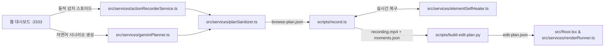

# AGENTS.md — Screen Demo Studio 아키텍처 및 엔지니어링 핵심 원칙

이 문서는 **Screen Demo Studio (`ai-screen-studio`)**의 아키텍처, 파이프라인, 그리고 AI 에이전트가 코드를 수정·검증할 때 반드시 준수해야 하는 핵심 엔지니어링 원칙을 정의합니다.

---

## 1. 프로젝트 개요 및 핵심 철학 (Core Philosophy)

* **프로젝트명**: Screen Demo Studio (`ai-screen-studio`)
* **대시보드 주소**: `http://localhost:3333` (`npm run dashboard` / `scripts/dashboard-server.ts`)
* **핵심 철학 2대 원칙**:
  1. **클릭한 대로 정확히 재현 (What You Click Is What Gets Recorded)**:
     사용자가 동작 감지(스포이드, `actionRecorderService.ts`)로 직접 클릭·호버·드래그·타이핑한 액션은 재생 엔진(`scripts/record.ts`)에서 **사용자가 의도한 바로 그 요소**에 1:1로 정확히 재현되어야 합니다. 엉뚱한 첫 번째 행을 클릭하거나 배경 버튼을 오클릭하는 일을 원천 차단합니다.
  2. **전 모듈 범용 설계 (Universal Multi-Module Design — No Single-Scenario Hacks)**:
     일정관리, 전자결재, 문서관리, 게시판, 자원예약, 스마트워크, 전자우편, 조직도 등 그룹웨어의 어떤 모듈에서 시나리오가 생성되더라도 동일하게 작동하는 **범용 메커니즘**으로 해결해야 합니다. 특정 시나리오 한두 개만 통과시키기 위한 하드코딩이나 `browse-plan.json` 수동 조작을 엄격히 금지합니다.

---

## 2. 시스템 파이프라인 및 주요 파일 구조



| 구분 | 파일 경로 | 역할 |
| :--- | :--- | :--- |
| **대시보드 서버/UI** | `scripts/dashboard-server.ts`, `dashboard/app.js` | 시나리오 관리, 스포이드 동작 감지, 녹화/렌더링 실행 및 SSE 로그 중계 |
| **동작 감지(스포이드)** | `src/services/actionRecorderService.ts` | 실시간 브라우저에서 사용자의 `click`, `hover`, `drag`, `type` 동작 및 `targetHtml` 포착 |
| **AI 플래너 & 카탈로그** | `src/services/geminiPlanner.ts`, `src/services/groupwareCatalog.ts` | 자연어 프롬프트 기반 시나리오 생성 및 그룹웨어 모듈별 표준 DOM 규격 제공 |
| **플랜 정제기** | `src/services/planSanitizer.ts` | 셀렉터 문법 정규화, `targetHtml` 기반 고유 속성/텍스트 보강, 불필요 단계 정리 |
| **브라우저 녹화 엔진** | `scripts/record.ts` | Playwright 기반 시나리오 재생, 모달/트리/드래그/피커 제어, `recording.mp4` & `moments.json` 생성 |
| **실시간 자가 치유** | `src/services/elementSelfHealer.ts` | 런타임 요소 탐색 실패 시 실시간 DOM 후보군 + 화면 캡처 기반 멀티모달 복구 |
| **편집 플랜 & 렌더링** | `scripts/build-edit-plan.py`, `src/SyntheticCursor.tsx`, `src/services/renderRunner.ts` | 줌/팬 키프레임 산출, 가상 마우스 커서/클릭 물결 합성, 최종 MP4 렌더링 |

---

## 3. 6대 핵심 엔지니어링 원칙 (Engineering Rules)

### 원칙 1. 동작 감지(스포이드) 셀렉터 생성 정밀화 (`actionRecorderService.ts`)
1. **고유 식별 속성 및 정확 텍스트 최우선 배치**:
   - 동적 목록이나 트리(`#orgUserList`, `#resSelect_resList`, `.dynatree-container` 등)에서 `:nth-of-type(n)` 같은 **순서 의존 셀렉터**를 맨 앞에 두면 목록 순서가 바뀌거나 다중 항목이 있을 때 엉뚱한 첫 번째 항목을 클릭하게 됩니다.
   - 반드시 **`id` / `name` / 고유 데이터 속성(`data-res-id`, `data-dept-id`, `data-emp-id`, `data-cmp-id`, `data-cal-id`, `data-brd-id`) → 정확한 텍스트/타이틀 매칭(`:text-is('...')`, `[title='...']`, `:has-text('...')`) → 구조적 경로(`:nth-of-type`)** 순서로 후보 셀렉터를 구성합니다.
2. **일시적 런타임 상태 클래스 제거**:
   - `.dynatree-expanded`, `.dynatree-has-children`, `.dynatree-folder`, `.dynatree-lastsib`, `.dynatree-exp-*`, `.dynatree-ico-*`, `.ui-state-*`, `.hover`, `.active`, `.focus` 등 클릭 시점의 UI 상태에 따라 변하는 클래스는 셀렉터에서 제외합니다.
3. **특수 인터랙션 누락 방지**:
   - **호버(`hover`)**: GNB 메뉴, 양식 카드(`.app_work_box`, `li.aw_li`), 드롭다운 래퍼 등 마우스 오버 시 하위 요소가 나타나는 컨테이너는 디바운싱을 통해 `hover` 액션을 자동 기록합니다.
   - **드래그 앤 드롭(`drag`)**: 네이티브 HTML5 `dragstart`/`drop`뿐 아니라 jQuery UI Sortable/Draggable(`mousedown` → `mouseup` 거리 이동)도 감지하여 `sourceSelector`와 `targetSelector`를 기록합니다.
   - **달력/시간 피커(`mousedown`)**: `#ui-datepicker-div td a` 및 `.ui-timepicker-list li`처럼 `mousedown`에서 값을 반영하고 즉시 닫히는 위젯은 `mousedown` 캡처 단계에서 즉시 기록합니다.

### 원칙 2. 플랜 정제기(`planSanitizer.ts`) 보존 및 보강 규칙
1. **`recordedByEyedropper: true` 액션 존중**:
   - 사용자가 직접 녹화한 액션의 의도를 임의로 삭제하거나 엉뚱한 셀렉터로 덮어쓰지 않습니다.
   - 단, `targetHtml`이 존재하는 경우 `1-E` 정제 단계에서 `targetHtml` 내부의 `data-res-id`/`data-dept-id`/`data-emp-id` 및 정확한 `[title='...']`, `:text-is('...')` 셀렉터를 추출하여 `:nth-of-type(n)` 후보보다 앞쪽에 보강합니다.
2. **일정 등록 버튼 vs 저장 버튼 구분**:
   - 좌측 사이드바의 `[일정 등록]` 버튼(`#reg_shedule_lefttop`)이 모달 하단 `[저장]` 버튼(`#savebtn`)으로 덮어써지지 않도록 엄격히 구분합니다.

### 원칙 3. 모달 스코핑, 팝업 컨텍스트, 트리/조직도 정밀 제어 (`scripts/record.ts`)
1. **최상단 활성 모달(`.ui-dialog:visible`) 스코핑 및 메인 폼 보호**:
   - 화면에 `.ui-dialog:visible` 모달이 열려 있을 때는 가장 높은 `z-index`를 가진 최상단 모달 내부에서만 요소를 탐색합니다.
   - `autoRecoverActiveModals()`는 `#subject`, `#savebtn`, `textarea#cn`, `#eapDocReg_docSubject`, `#atclReg_subject` 등을 포함한 **메인 등록/작성 모달**을 절대 방해 팝업으로 오인하여 닫지 않습니다.
2. **시스템 알림창(`[확인]`) 오클릭 방지**:
   - 트리/조직도 선택 팝업 닫힘 직후 알림창 확인 버튼을 탐색할 때는 오직 `#alert_lyr:visible button:has-text('확인')`, `button#naon-cmm-alert-confirm:visible`, `.ui-dialog.alert_dialog:visible button:text-is('확인')`만 매칭해야 하며, 바닥에 있는 본문 모달의 `<button>사용자 일정확인</button>` 등을 클릭해서는 안 됩니다.
3. **`window.opener` 오염 금지**:
   - 모든 일반 페이지에 무조건 `window.opener = window`를 주입하면, 그룹웨어 스크립트(`ScdInsertScheduleDetailView` 등)가 레이어 모달을 별도 `window.open` 팝업 창으로 오인하여 저장 후 모달 자동 닫기(`closeDialog`)와 캘린더 갱신(`ObserverControl.notifyObservers`)을 수행하지 않습니다.
   - 오직 `window.open`이 호출되어 단일 캔버스 유지를 위해 리다이렉트된 경우에만 `sessionStorage` 플래그(`__studio_simulated_popup__`)를 통해 `window.opener`를 설정합니다.
4. **조직도 부서 폴더 vs 사원 목록 체크박스 분리**:
   - 사원 행(`label.user_info.chkbox`, `input.lst_chk`) 텍스트에는 소속 부서명(예: `'test002 테스트 부서 (유니슨)'`)이 함께 포함됩니다. 따라서 사원 체크박스 클릭 액션을 부서 트리 폴더 클릭으로 오분류하지 않도록 명확히 구분합니다.
   - 체크박스가 포함된 `<label>`을 클릭할 때는 `resolveAtomicTarget()`이 내부 `<input type="checkbox">`를 정확히 타겟팅하여 실제 체크 상태가 변경되도록 보장합니다.
5. **달력/시간 피커 및 자원예약(`[예약불가]`) 시간 충돌 방지**:
   - 날짜/시간 입력창 클릭 시 열린 달력/시간 선택기 오버레이가 후속 요소(중요도 별점 등)를 가리지 않도록 선택 후 깔끔하게 닫습니다.
   - 반복 테스트로 인해 동일 시간대에 회의실/자원이 중복 예약되어 `[예약불가]`가 발생하는 것을 방지하기 위해, 주간 캘린더 내 비어 있는 미래 시간대를 우선 선택하고 충돌 감지 시 자동으로 가용 시간대로 조정합니다.

### 원칙 4. 실시간 AI 자가 치유 (`elementSelfHealer.ts`)
1. **무추측 원칙 (Zero-Guessing Policy)**:
   - 화면에서 실시간 추출한 `LiveDOMCandidate` 목록에 존재하지 않는 가상 ID를 추측하여 생성하지 않습니다.
2. **2-Pass 클린 마스터 재녹화**:
   - 1차 녹화 중 자가 치유(`totalHealedCount > 0`)가 발생하여 대기 공백이 생겼다면, 치유된 셀렉터를 `browse-plan.json`에 영구 반영한 뒤 자동으로 `--clean-pass` 재녹화를 수행하여 끊김 없는 최종 영상을 생성합니다.

### 원칙 5. 검증 및 운영 수칙 (Operational & Verification Rules)
1. **`browse-plan.json` 수동 편집 절대 금지**:
   - 테스트를 통과시키기 위해 `data/<slug>/browse-plan.json`을 직접 수정하지 마십시오. 시나리오 정제가 필요하면 `planSanitizer.ts`를, 캡처 개선이 필요하면 `actionRecorderService.ts`를, 런타임 재생 개선이 필요하면 `scripts/record.ts`를 수정해야 합니다.
2. **백그라운드 데몬 실행 금지 (`IsDaemon: false`)**:
   - 명령어 실행 시 `IsDaemon: true`로 백그라운드 프로세스를 띄우지 마십시오.
3. **프레임 단위 시각 검증 (Visual Frame Verification)**:
   - 녹화 테스트 후에는 반드시 `recording.mp4`에서 프레임을 추출하여 실제 화면에서 체크박스 선택, 팝업 닫힘, 입력값 반영, 최종 저장 결과가 정상인지 눈으로 확인한 뒤 작업 완료를 보고하고, 검증용 임시 프레임 이미지는 즉시 삭제합니다.

---

## 4. 자주 쓰는 실행 명령어

```bash
# 1. 웹 대시보드 서버 실행 (http://localhost:3333)
npm run dashboard

# 2. 특정 시나리오 브라우저 녹화 실행 (헤드리스 / 화면 표시)
npx tsx scripts/record.ts <slug> --headless
npx tsx scripts/record.ts <slug> --headed

# 3. 줌/팬 편집 플랜 단독 재생성
python scripts/build-edit-plan.py data/<slug>/

# 4. TypeScript 전체 타입 검사
npx tsc --noEmit
```
